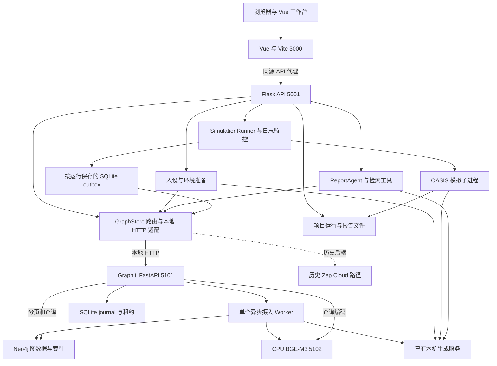
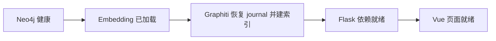
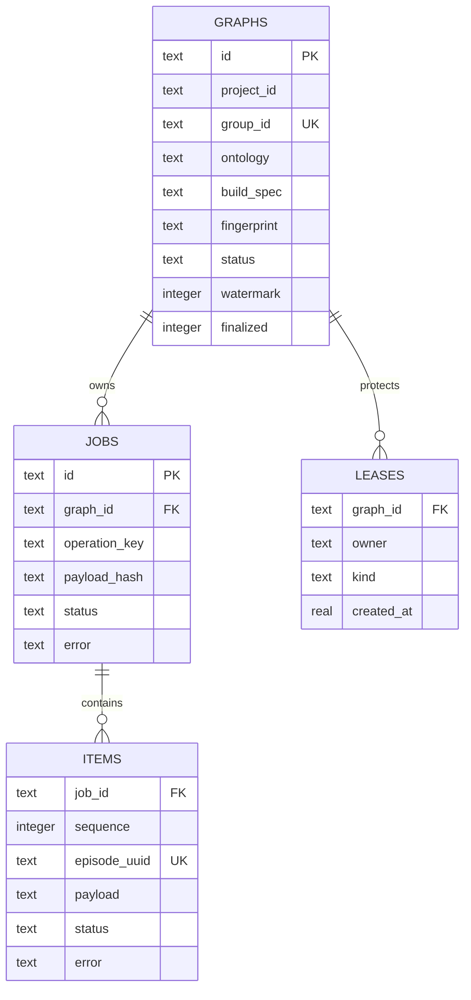
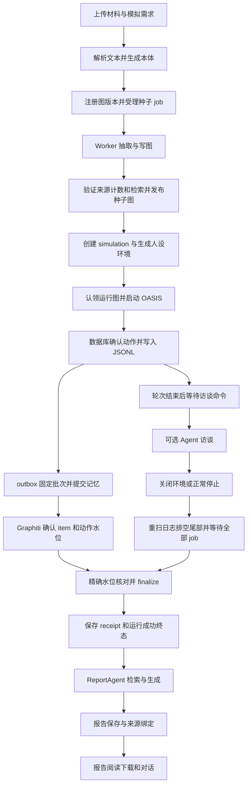
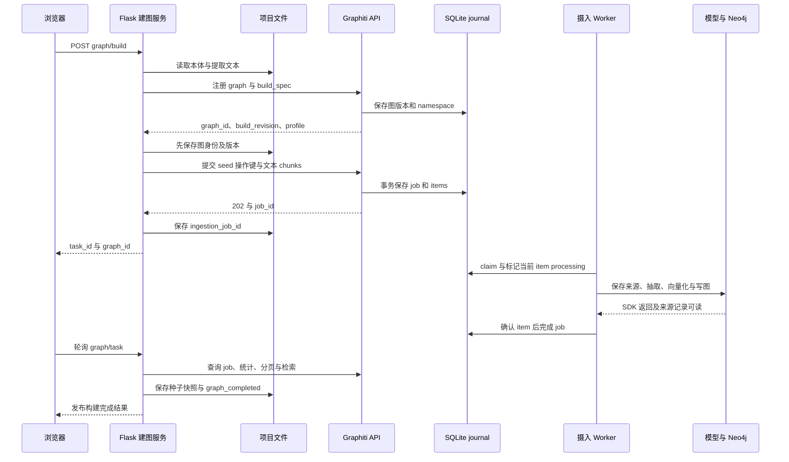
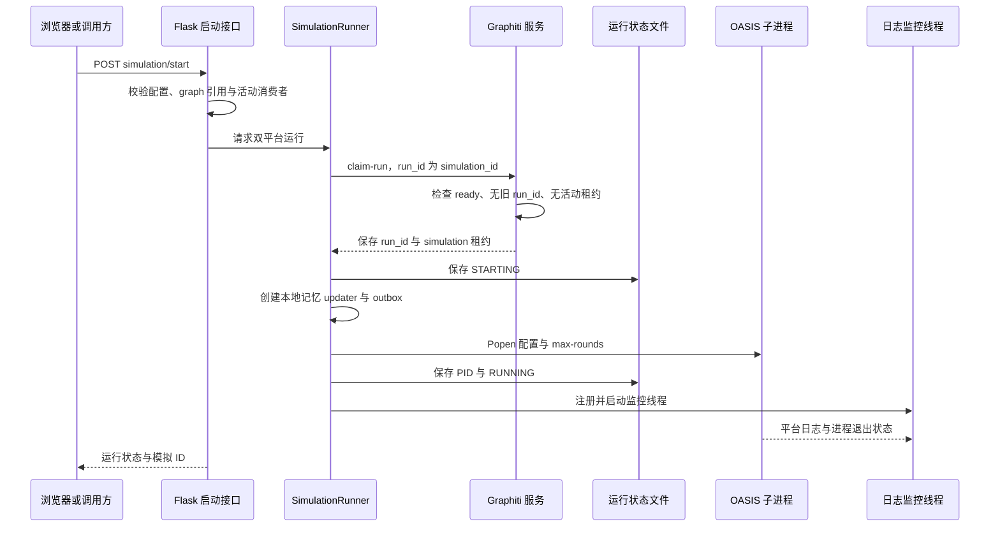
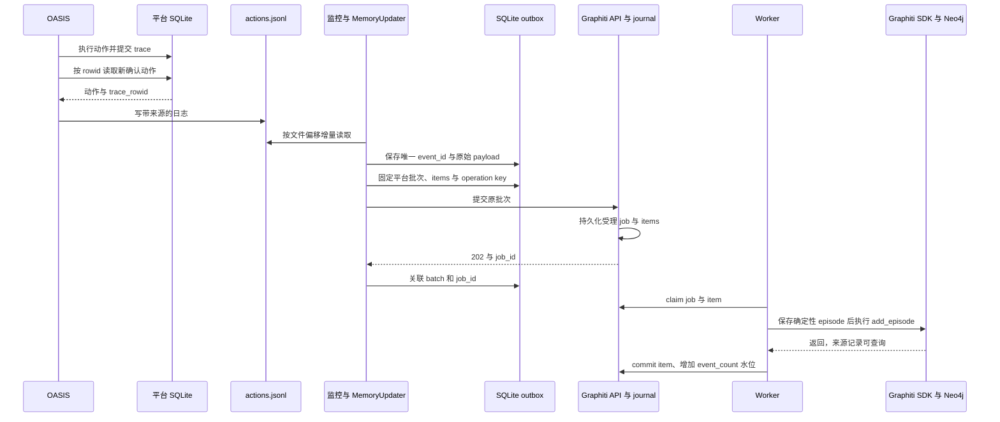
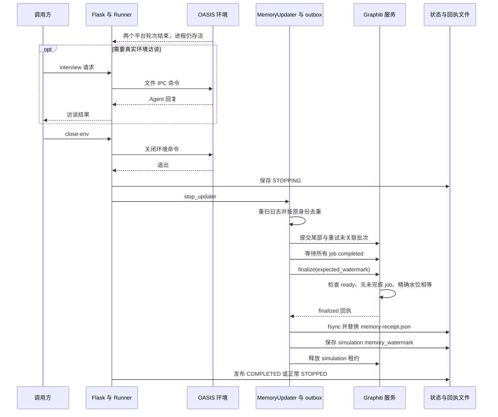
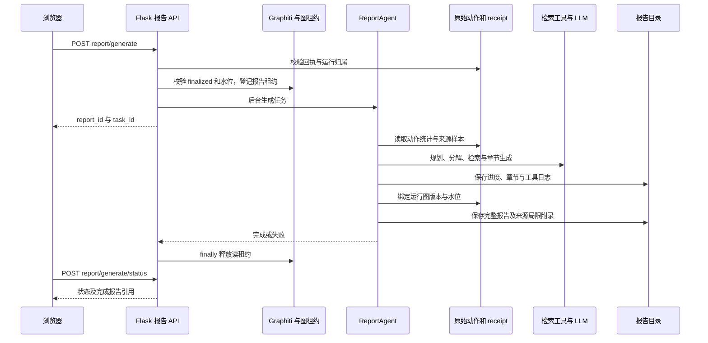
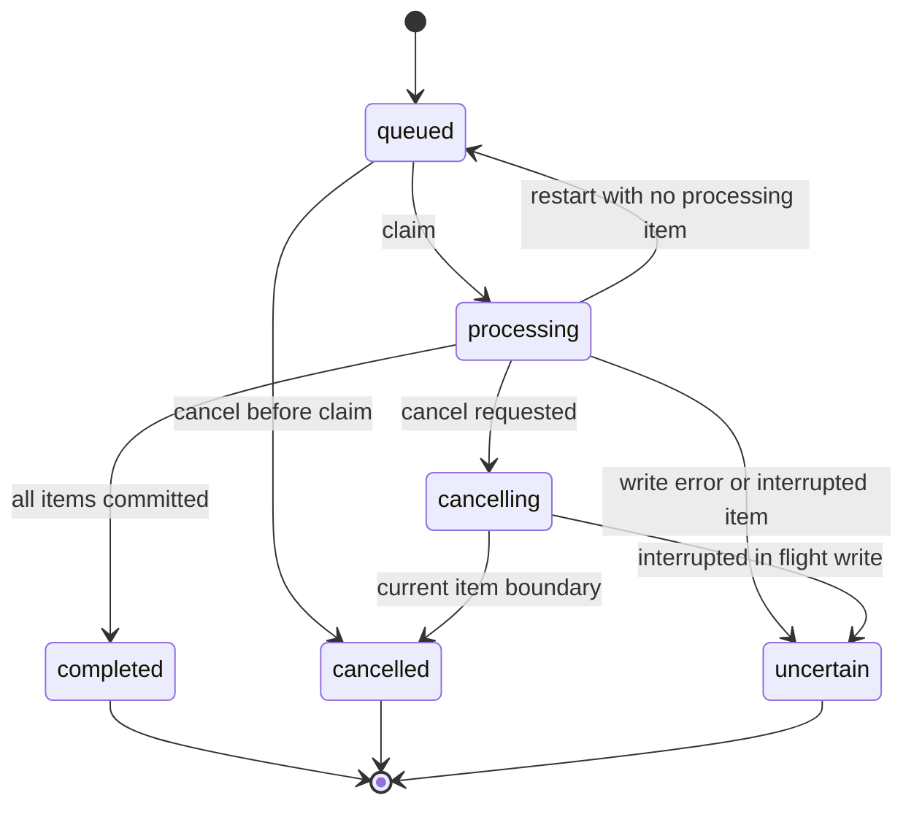

# MiroFish 技术架构与主流程说明

本文面向项目开发、维护和技术评审人员，说明本仓库本地 Graphiti 版本的组件边界、数据组织、主流程、完成判据及故障恢复机制。代码基线为 `feat/graphiti-local` 分支的 `6aecba7`，日期为 2026 年 10 月 26 日。

系统采用 Vue 前端、Flask 业务编排、OASIS 模拟子进程、独立 Graphiti 异步服务、Neo4j 和 CPU BGE-M3。原始材料、平台动作、摄入确认及报告来源分别持久化；通过运行图引用、操作幂等键和精确水位把各阶段关联起来。

本版仍是单机部署：Graphiti 仅运行一个持久化摄入 Worker；每张图只允许一次模拟；准备与报告的全部执行状态尚未迁移到持久化任务系统。文中的时序图描述当前实现，不代表已经具备多副本调度、跨库事务或不可变种子图克隆。

使用步骤见[操作手册](MiroFish操作手册.md)，真实业务输出与验收依据见[案例与功能说明](MiroFish案例与功能说明.md)。

## 目录

1. [架构目标与主要决策](#1-架构目标与主要决策)
2. [总体组件架构](#2-总体组件架构)
3. [部署与运行拓扑](#3-部署与运行拓扑)
4. [后端分层与 Cloud 兼容](#4-后端分层与-cloud-兼容)
5. [标识数据模型与存储](#5-标识数据模型与存储)
6. [接口契约与错误处理](#6-接口契约与错误处理)
7. [端到端主流程](#7-端到端主流程)
8. [材料本体与种子建图流程](#8-材料本体与种子建图流程)
9. [人设准备与模拟启动流程](#9-人设准备与模拟启动流程)
10. [动作确认与记忆摄入流程](#10-动作确认与记忆摄入流程)
11. [环境结束与记忆完成屏障](#11-环境结束与记忆完成屏障)
12. [报告生成与互动流程](#12-报告生成与互动流程)
13. [图谱查询与时间语义](#13-图谱查询与时间语义)
14. [状态机并发与删除保护](#14-状态机并发与删除保护)
15. [幂等中断与恢复](#15-幂等中断与恢复)
16. [配置模型与可观测性](#16-配置模型与可观测性)
17. [验证结果与扩展边界](#17-验证结果与扩展边界)
18. [核心源码索引](#18-核心源码索引)

## 1 架构目标与主要决策

改造把原有 Cloud 图谱耦合拆出本地通道，使材料建图、Agent 上下文、模拟记忆、报告检索和报告对话可以在本机完成。重点是保留可确认的执行结果和来源，不把“请求成功发送”误当成“事实已经入库”。

| 决策 | 当前实现 | 原因与代价 |
|---|---|---|
| 隔离异步 SDK | Graphiti 在独立 FastAPI/Uvicorn 进程中维护事件循环与连接 | Flask 不跨请求持有 Neo4j 异步驱动；增加服务间 HTTP 边界 |
| 图数据库 | Neo4j 5.26.0 Community，固定 ARM64 镜像 digest | 当前已验证；FalkorDB 未启用，其他架构需另行验证 |
| 向量 | CPU BGE-M3，1024 维，CLS 与 L2 | 不占用生成服务 GPU，运行时不下载权重；CPU 摄入吞吐需按实际负载评估 |
| 检索排序 | 显式混合检索与 RRF | 无外部 reranker；CrossEncoder 路径被禁止 |
| 持久化摄入 | SQLite journal、单 Worker、逐 item 确认 | 可解释中断位置；SQLite 与 Neo4j 不是原子事务 |
| 模拟记忆 | 每次运行一个 SQLite outbox | 固定来源身份、批次和幂等键；不是独立消息中间件 |
| 运行隔离 | 每图一次模拟，种子图和运行图 ID 相同 | 阻止重复运行污染；没有按运行复制不可变种子图 |
| 完成发布 | 精确水位、finalize、receipt、成功运行终态 | 图写回失败时拒绝生成最终报告 |
| 历史兼容 | 按项目与图版本保存的后端路由 | 缺字段旧记录默认 Cloud；不自动迁移 Cloud 图数据 |

## 2 总体组件架构

上图的 GraphStore 是业务边界，不是所有旧代码都已重写成一个完整的对称双后端 SDK。旧 reader、builder、memory 和 tools 类仍存在，按保存的后端走本地适配或原 Cloud 实现。

| 组件 | 主要职责 | 不承担的职责 |
|---|---|---|
| Vue 工作台 | 五步页面、图谱和动作展示、进度轮询、报告阅读和互动 | 不直接访问 Neo4j 或携带 Graphiti 服务令牌 |
| Flask API | 项目管理、文件解析、业务前置校验、准备/运行/报告编排 | 不直接承载 Graphiti 异步连接池 |
| GraphStore 适配 | 后端选择、同步 HTTP、DTO、分页导出、等待与租约调用 | 不执行本地事实抽取 |
| OASIS 子进程 | 本机平台、Agent 行为、平台 SQLite、命令等待 | 不直接决定图谱记忆是否全部完成 |
| Graphiti 服务 | 本体编译、摄入受理、Worker、图读取、搜索与完成确认 | 不负责整个 MiroFish 工作流的所有后台任务 |
| Neo4j | Graphiti 实体、事实关系、来源及索引 | 不保存项目上传目录或报告文件 |
| Embedding 服务 | 固定模型的 OpenAI 兼容向量接口 | 不生成自然语言，也不提供通用模型切换 |
| 生成服务 | 本体、人设、模拟回复、事实抽取和报告所需生成能力 | 不由本项目管理脚本自动启停 |

## 3 部署与运行拓扑

### 3.1 进程边界

当前 Compose 只管理 Neo4j。前端、Flask、Graphiti 和 Embedding 都由生命周期脚本在宿主机的独立进程中启动，Python 服务使用各自虚拟环境。OASIS 是业务运行时再创建的子进程，不是常驻 Compose 服务。

| 服务 | 运行方式 | 端口与监听 |
|---|---|---|
| 前端 | npm/Vite | 3000；默认 127.0.0.1，可设 `MIROFISH_WEB_HOST=0.0.0.0` |
| Flask | `backend/run.py`，单进程、线程化请求 | 127.0.0.1:5001 |
| Graphiti | Uvicorn 与应用 lifespan | 127.0.0.1:5101 |
| Embedding | Uvicorn，启动时加载 CPU 模型 | 127.0.0.1:5102 |
| Neo4j | Docker Compose | 本机 7687 Bolt、7474 HTTP |
| 共享 LLM | 已有独立服务 | 验收端点为本机 30000，实际由其自身部署管理 |

局域网访问只需前端 3000。前端把 `/api` 代理到 `127.0.0.1:5001`；浏览器 API 模块使用相对路径并规整重复 `/api` 前缀。Vite 设置 `strictPort`，冲突时退出而非自动换端口。

### 3.2 服务生命周期

`start.sh`、`stop.sh`、`restart.sh`、`status.sh` 通过 `scripts/local-stack.sh` 调用管理器。管理器维护进程身份、工作目录和 PID，使用 `lifecycle.lock` 排除并发启停。

停止顺序相反。停止保留数据卷与文件；共享生成服务独立管理。管理器不是进程自动拉起监督器，也没有实现开机自启。停服务前仍应按业务生命周期结束活动模拟并确认记忆。

## 4 后端分层与 Cloud 兼容

### 4.1 业务编排层

Flask 的三个主要蓝图为 `/api/graph`、`/api/simulation` 和 `/api/report`。项目元数据用于关联文件、本体、图版本和需求；SimulationManager 管理人设与环境配置；SimulationRunner 管理实际进程和收尾；ReportAgent 使用检索和原始动作证据生成报告。

准备和报告通过原有 TaskManager 与后台线程执行。TaskManager 是 Flask 进程内的线程安全单例，没有改造成共享数据库任务队列。不能从 Graphiti job 的持久化能力推导出所有 Flask 后台线程都能重启续跑。

### 4.2 GraphStore 边界

`protocol.py` 定义创建、提交、查询任务、节点/关系分页、邻接、检索、统计、完成和删除能力。LocalStore 还实现 export、wait、取消和租约等辅助方法。

后端选择顺序：找到 graph 所属项目的当前引用，或 `graph_versions` 中的历史条目，再使用其中保存的 `graph_backend`；无法找到后端信息时默认走历史 Cloud 语义。不会从 graph ID 前缀猜测类型。

`LazyCloudClient` 使旧服务类可以先实例化，再根据 graph 后端决定是否建立 Cloud 客户端。这样本地流程不会仅因没有 Cloud key 就失败或跳过关系上下文。

### 4.3 当前兼容程度

`ZepCloudStore` 是复用旧 SDK 的轻量封装，当前主要覆盖 export、search、delete；它没有完整实现 Protocol 的全部方法。其余 Cloud 行为仍由原 builder、reader、updater 与 tools 路径处理。

因此当前实现是“集中后端选择 + 本地完整通道 + 历史兼容分支”，还不是可以把任意 GraphStore 方法无条件替换成任意后端的插件框架。新增后端时应逐项补齐业务契约和回归，而不是只扩展工厂枚举。

## 5 标识数据模型与存储

### 5.1 标识关系

| 标识 | 当前含义 | 注意事项 |
|---|---|---|
| `project_id` | 上传材料与需求所属项目 | 可保存多个图版本 |
| `graph_id` | 业务可见的图谱版本标识 | 本地形式为 `graph_` 加随机 ID |
| `group_id` | Neo4j 内部 namespace | 本地 `build_revision` 返回该值，形如 `mf_...` |
| `embedding_profile_id` | 服务启动时配置摘要 | 名称虽为向量 profile，摘要还包含部分 LLM 配置 |
| `simulation_id` | 人设、平台配置与一次运行的归属 | 首期每图只认领一个运行 |
| `run_id` | 本次运行来源标识 | 当前直接使用 simulation ID |
| `ingestion_job_id` | 独立摄入任务 | 本地种子任务也投影为 graph task ID |
| `episode_uuid` | Graphiti 来源记录 | 根据图、操作键和 item ID 确定性生成 |
| `report_id` | 报告及其章节和日志 | 保存运行图、版本及水位 |
| 准备/报告 `task_id` | TaskManager 的进程内任务键 | 不能假设具有 `task_` 前缀，也不能与持久化 job 混用 |

SimulationState 保存 `graph_backend`、`source_graph_id`、`run_graph_id`、`run_id` 和 `memory_watermark`。首期 source 与 run graph 相同，不表示已经创建图克隆。

### 5.2 四类存储

| 存储 | 内容 | 所有者 |
|---|---|---|
| 项目、运行、报告文件 | 文本、本体、配置、人设、状态、回执、报告 | Flask 与模拟进程 |
| 平台 SQLite | 帖子、评论、用户和 trace | OASIS |
| 每运行 outbox SQLite | 原始事件身份、序号、批次、输入及 job 关联 | 本地记忆更新器 |
| Graphiti journal SQLite 与 Neo4j | 摄入台账/租约/水位，与实体/事实/来源图 | Graphiti 服务 |

这些存储分别落盘，没有跨全部存储的统一事务。恢复时必须核对它们所指向的同一次运行和版本。

### 5.3 Journal 关系模型

`items` 的主键为 `(job_id, sequence)`；`leases` 的主键为 `(graph_id, owner)`；`jobs` 对 `(graph_id, operation_key)` 加唯一约束。`ontology`、`build_spec` 和 `payload` 以规范 JSON 文本保存。数据库同时启用 WAL、FULL 同步和外键。

`graphs.watermark` 在 item 确认时增加该 payload 的 `event_count`；种子 item 的 event_count 为 0。`finalized` 是独立布尔标记，不是额外的 graph status 字符串。

### 5.4 Outbox 模型

| 表 | 关键内容 |
|---|---|
| `meta` | 运行记忆参考时间 `reference_time` |
| `events` | 自增 seq、唯一 event_id、原始 payload、platform、eligible、batch_key |
| `batches` | operation_key 主键、已固定的 items JSON、可为空的 job_id |

outbox 的 job_id 是跨服务关联值，不是到 journal 文件的 SQLite 外键。HTTP 响应丢失时，batch 可能已在服务受理，但本地 job_id 仍为空；重试必须使用该行原来的 key 和 items。

### 5.5 Neo4j 与文件对象

Neo4j 主要保存 Entity、Episodic、事实关系及 Graphiti 索引。本地展示把业务事实关系投影为 node/edge DTO，不直接把 SDK 对象或 embedding 数组传给前端。

| DTO | 核心字段 |
|---|---|
| Node | uuid、name、labels、summary、created_at、attributes |
| Edge | uuid、name、fact、fact_type、source_node_uuid、target_node_uuid、episodes、created_at、valid_at、invalid_at、expired_at、attributes |

`episodes` 是来源 UUID 列表，不是原始动作列表。实际来源链为 trace → JSONL 偏移 → outbox event → batch payload → episode → 事实边。

项目目录保存 `project.json`、`extracted_text.txt` 和种子快照；模拟目录保存配置、人设、两个平台数据库及日志、outbox 和 receipt；报告目录保存 meta、章节、完整 Markdown 与日志。完整路径表见操作手册。

## 6 接口契约与错误处理

### 6.1 浏览器到 Flask

浏览器请求使用 `/api/graph`、`/api/simulation`、`/api/report`。成功业务响应通常包装为 `{"success":true,"data":...}`。准备和报告是异步业务任务，调用方根据实际 task ID 或 simulation ID 查询进度。

本地建图返回的 task ID 指向 Graphiti 持久化 job，由 Flask 投影成原前端可读的建图进度结构；它不依赖旧 TaskManager 内存记录。报告状态接口为 `POST /api/report/generate/status`，不能照旧接口注释中的 GET 使用。

### 6.2 Flask 到 Graphiti

内部前缀是 `/internal/v1`，正常调用带 `Authorization: Bearer <token>`、`X-Graph-Protocol: 1` 和请求 ID。服务检查协议版本与令牌，并为正常处理中间件响应设置协议和请求 ID 头。内部服务返回直接 JSON，不使用 Flask 的 success/data 包装。

| 方法与资源 | 行为 |
|---|---|
| `POST /graphs` | 校验本体，保存 graph、namespace、build_spec 和配置指纹 |
| `POST /graphs/<id>/ingestions` | 事务受理后返回 202，包含 job 状态 |
| `GET /jobs/<id>` | 返回 job 及 item 的确认情况、episode UUID |
| `POST /jobs/<id>/cancel` | 持久化取消请求，活动写入在 item 边界收尾 |
| `GET /graphs/<id>/nodes` 与 `/edges` | 完整版本的游标分页 |
| `POST /graphs/<id>/search` | scope、时间模式与 limit 约束的检索 |
| `POST /graphs/<id>/claim-run` | 单图运行认领及模拟租约 |
| `POST /graphs/<id>/finalize` | 严格核对预期水位 |
| `GET /graphs/<id>/metadata/details` | 读取图元数据、job 概要和租约 |
| `POST /graphs/<id>/leases` | 登记 report、simulation 或 export 消费者 |
| `DELETE /graphs/<id>` | 检查占用后删除目标 namespace |

摄入请求接受 1～1000 个 items；单 item 正文最多 20000 字符，参考时间必须有时区，event_count 非负。item_id 在同一请求内唯一。本地向量服务另要求 1～16 个非空字符串、最大 8192 token、正确模型名及 float 编码。

### 6.3 错误映射

| 位置 | 错误 | 对调用方的含义 |
|---|---|---|
| 内部鉴权 | 401 | token 不匹配 |
| 内部输入/协议 | 400 或 FastAPI 422 | 参数或协议不合法 |
| 内部节点/任务 | 404 | 本 namespace 无此对象或任务不存在 |
| 内部状态 | 409 | 图忙、幂等冲突、未完成屏障、需重建 |
| 内部依赖异常 | 503 | 数据库、模型等失败；业务响应不直接暴露原异常细节 |
| Flask LocalStore | 404 → GraphNotFound | 映射为 Flask 404 |
| Flask LocalStore | 400/409/422 → GraphBusy | 统一通过 Flask 409 返回，保留可读消息 |
| Flask LocalStore | 传输失败或其他依赖错误 | DependencyUnavailable，Flask 503 |

HTTP 超时不证明服务没有受理。写入请求异常后，应通过原图、原 job 或原 operation key 核对，而不是用一个新 key 再写相同来源。

## 7 端到端主流程

| 阶段 | 入口 | 关键输出与完成条件 |
|---|---|---|
| 材料与本体 | graph/ontology/generate | 提取文本、本体、project ID |
| 种子建图 | graph/build、graph/task | job 完成，实体关系非空、来源完整、可读取检索 |
| 环境准备 | simulation/create、prepare | 人设、simulation_config、准备结果 |
| 模拟 | simulation/start、run-status | 平台动作和运行进度；轮次结束不等于终态 |
| 访谈与关闭 | interview、close-env | 访谈响应、子进程退出 |
| 记忆收尾 | 内部 stop_updater 与 finalize | 回执、精确水位、成功运行终态 |
| 报告 | report/generate、generate/status | completed 报告、版本及水位绑定 |
| 报告互动 | report/chat | 对应运行图上的检索与生成回答 |

## 8 材料本体与种子建图流程

### 8.1 本体生成

Flask 解析上传文件并保存提取文本，由现有本体生成器调用后端配置的生成模型，返回本体 JSON。它与 Graphiti Worker 内的事实抽取是两类独立调用：前者决定类型结构，后者按该结构抽取具体来源事实。

Graphiti 接收本体时使用 `pydantic.create_model` 编译属性，校验标识符、保留字段、重复定义、类型和关系端点，不执行生成的 Python 代码。

### 8.2 种子建图时序

### 8.3 构建输入与复用

build_spec 保存提取文本 SHA256、chunk_size、chunk_overlap、reference_time 和社区摘要状态。默认分块参数为 500/50，实际按文本分块器处理，不等于向量 token 上限。

种子 operation key 为 `seed:<source_sha256>`，每块 item_id 为 `chunk:<index>`，并带 chunk index 和块摘要。原输入和时间必须稳定，才能在响应丢失后重用相同 payload。

若服务已受理而 Flask 尚未存 job ID，刷新逻辑从已保存 graph 的 metadata 查找 seed job。它能恢复这类已有图身份的摄入关联；注册图响应丢失而本地尚未保存身份的孤立 namespace，不会因此自动获得完整回收机制。

### 8.4 完成发布条件

`refresh_build` 不只检查 job 字符串 completed，还读取节点、关系和来源，做全量导出与检索检查，再保存种子快照。普通建图记录 `communities=optional_not_built`，不会默认调用社区摘要生成。

force build 创建新版本并保留旧图元数据。重建前检查活动租约和在途 job；不把当前图中的 uncertain 写入直接改为完成。

## 9 人设准备与模拟启动流程

### 9.1 人设与配置生成

1. 创建 simulation，保存项目、后端和 source/run graph 引用。
2. prepare 在本地图上持有 `prepare_<simulation_id>` 读租约，复用 report 种类，防止删除与新运行认领交错。
3. EntityReader 完整读取实体，按显式角色类型或默认角色后缀筛选。
4. ProfileGenerator 使用实体摘要、关系上下文和材料生成平台人设。
5. 配置生成器产生时间、活跃度、初始帖子、热点及平台推荐参数。
6. 保存人设、simulation_config 与准备状态，释放准备租约。

准备可以通过已有结果检查避免重复生成，但后台执行和 TaskManager 进度仍在 Flask 内存中。已保存文件可读，不代表后台线程中断后自动从中间步骤续跑。

### 9.2 运行认领与进程创建

服务端 claim-run 在 SQLite 事务中保存图的 run_id 和 simulation 租约；图已经认领过就拒绝再次使用。Flask 同时使用按 simulation 和 graph 的进程内锁，排除同一实例内的启动、停止和删除竞争。

`STARTING` 在启动昂贵资源之前持久化，避免两个并发请求都认为模拟尚未运行。子进程使用模拟目录作 cwd、独立进程组，并把 stdout/stderr 写文件，避免管道缓冲阻塞。

### 9.3 实际轮数

实际执行轮数受计划轮数和 `max_rounds` 上限共同约束。当前网页滑块最低为 10；三轮通过运行页 `?maxRounds=3` 或 API 明确指定，不能只写在自然语言需求里。

本文的主运行通道为已验收的 `platform=parallel`。本地单平台参数的脚本接线限制见第 17 节，不能由 API 参数枚举直接推断其已完成单平台验收。

## 10 动作确认与记忆摄入流程

### 10.1 以数据库确认动作

OASIS 双平台分别使用自己的 SQLite 数据库。初始帖和后续轮次动作都先执行，再从 trace 表按 rowid 游标读取确认结果，随后写入平台 JSONL。

原始日志携带数据库路径、trace_rowid 和 origin；第 0 轮标记 initial_configuration，后续轮次为 agent_action。注册和刷新是 trace 内部记录，不记为核心动作。动作展示 DTO 会精简字段，原始来源审计仍应回到 JSONL 与平台库。

数据库确认只能证明该模拟动作已经落库，不证明生成内容符合原始材料或现实世界。人设扩展、虚构名字和偏离时间约束仍需要人工审核。

### 10.2 Outbox 与 Worker 时序

### 10.3 三层身份

| 层级 | 身份生成 | 用途 |
|---|---|---|
| 原始事件 | `simulation_id:platform:文件名:offset` | 重扫同一条来源时幂等，区分内容相同的不同动作 |
| 记忆操作 | `memory:<simulation_id>:SHA256(有序事件ID列表)` | 响应丢失后仍使用同一批次 |
| 来源 episode | UUID5，输入为 graph_id、operation_key、item_id | 稳定来源身份，便于恢复核对 |

原始 payload 内的文件路径先规范化，避免相对路径不同写法导致同一来源冲突。若同一 event_id 对应不同内容，报错而不是默默忽略。

批次按平台、事件序号组成，最多 10 个符合写回条件的动作，正文合并为一个 item。事件、批次边界及完整输入先落盘；不能在 HTTP 超时后临时重新分批。尾部不足 10 条在结束时排空。

### 10.4 SDK 与台账的确认边界

Graphiti 0.31.2 的 `add_episode(uuid=...)` 会读取已存在的 episode，不是按传入 UUID 新建。Worker 因此先保存确定性 EpisodicNode，再带 uuid 调用抽取，并指定先前来源 episode。

SDK 返回后，Worker 查询来源 UUID 确认可读，再更新 journal item 和水位。这个查询是完成链上的一个校验点，并非证明每一条模型抽取事实都语义正确，也不使 Neo4j 与 SQLite 成为一个原子事务。

Worker 为 job 设置处理期限，按 item 检查剩余时间；遇到模型、图写入或取消中断等异常采取保守 uncertain 处理。一个全局 Worker 串行处理 job，SDK 内部并发由配置单独控制。

## 11 环境结束与记忆完成屏障

### 11.1 三种完成状态

| 状态 | 代表什么 | 是否足够生成最终报告 |
|---|---|---|
| 两个平台 simulation_end | 指定轮次的行为循环结束 | 否，环境可能仍等待命令 |
| OASIS 子进程退出 | 已关闭环境或停止进程 | 否，记忆可能还在摄入 |
| runner 成功终态 + receipt + 图 finalized | 日志已复扫、所有记忆 job 确认、水位一致 | 是，仍需通过报告版本与来源校验 |

双平台脚本默认在轮次后保留环境，通过模拟目录下的命令/响应文件接受 interview、batch_interview 和 close_env。API 通过 IPCClient 与该进程通信，不是由图谱服务模拟一个访谈回答。

### 11.2 收尾流程

监控器以运行进程结果确定期望终态，但先进入 STOPPING 并停止 updater。任何收尾失败都会使运行转 FAILED，而不是提前对 UI 发布 completed。

close-env 的成功响应可以仅表示关闭命令已发出，甚至在响应等待超时时保守返回“可能正在关闭”；最终以 runner、receipt 和服务端水位为准。

### 11.3 精确水位条件

预期水位为 outbox 中 `eligible=1` 的事件数；资格条件是非元事件、成功、不是 DO_NOTHING。提交水位为已确认 item 的 event_count 总和。finalize 要求所有 graph job completed、graph status 为 ready、两者相等。

本次案例：14 个初始动作 + 22 个自主动作 = 36。五个记忆批次加一个种子来源产生六个 episode；事实抽取后得到 62 条关系。动作数、批次数、episode 数和关系数是不同计量。

## 12 报告生成与互动流程

### 12.1 报告受理前置条件

报告 API 会检查运行器不处于 STARTING、RUNNING、PAUSED 或 STOPPING，且是成功 COMPLETED 或 STOPPED；项目图已构建完成，simulation 的图引用与当前项目匹配。

本地模式还读取该运行的 memory-receipt，检查 graph/run 归属、服务端 finalized 以及提交水位等于预期。已有 updater 仍活跃、摄入失败或版本改变时，返回 409。

在图生命周期锁内再次核对条件，再登记 report 读租约后启动后台线程。这样不能仅凭锁外检查结果就与删除操作交错。

### 12.2 报告生成时序

ReportAgent 保留 QuickSearch、PanoramaSearch、InsightForge 和环境访谈等工具意图。本地工具通过 LocalStore 检索；原始动作证据进入规划与章节上下文，避免仅对种子文本做改写。证据读取有顺序和样本上限，不是对每个动作都做完整人工语义复核。

保存阶段绑定 run_id、graph_id、build_revision 和 memory_watermark，并在完成 Markdown 后追加确定性的计数、来源定位与模拟局限。网页按模型章节渲染，完整下载文件包含额外附录，两者展示范围不同。

### 12.3 两条互动通道

| 通道 | 数据路径 | 环境条件 |
|---|---|---|
| 报告对话 | 已保存报告图引用 → report 租约 → 检索与 LLM | 不依赖 OASIS 环境继续存活 |
| Agent 对话/问卷 | simulation → IPC 命令 → OASIS 中的 Agent | 需要原模拟环境仍存活 |

报告聊天优先使用已保存报告的 graph ID，而不是一律读取项目的新图。旧 namespace 仍必须存在；报告文件存在不等于旧图已经不再需要。

报告已完成后可按 simulation ID 查询并在 Flask 重启后识别；正在生成的后台线程与 TaskManager 并不具有同等的重启续跑能力。新访谈也不会因为旧报告存在就自动复活已经关闭的 OASIS 环境。

## 13 图谱查询与时间语义

### 13.1 Namespace 隔离

节点、事实关系和邻接都按 group_id 约束；关系查询同时核对两端节点和关系的 namespace。节点 UUID 必须先在目标图内存在，不能凭一个全局 UUID 跨项目取邻接。

删除只匹配目标 group_id，不执行全库清空。这里的 namespace 是数据范围隔离，不是用户身份授权或租户权限模型。

### 13.2 分页与完整导出

节点、关系分别按 UUID 稳定排序，游标编码 namespace、集合和最后 UUID。每页多取一条判断 next_cursor；默认 100、上限 1000。

LocalStore.export 持有 export 租约，读取全部页并核对统计。它拒绝重复 UUID 和不前进游标。支持的 API 路径在导出期间不能接受新摄入或新运行认领，删除也受租约保护；这属于协作式并发约束，不是对任意外部 Cypher 写入都有效的数据库快照事务。

| 读取方式 | 当前状态约束 |
|---|---|
| 全量节点/关系分页与 export | graph 必须 ready，profile 匹配 |
| 节点、邻接、search | 拒绝 deleting、uncertain、failed，检查 profile；可在 ingesting 时读到部分变化 |
| stats 与 metadata | 用于诊断图、任务和水位；不等同于完整可读版本验证 |
| UI 图谱 | 记忆 ingesting 时优先展示保存的种子快照及标签 |
| 报告 | 还需独立的运行终态、receipt 与 finalize 门禁 |

因此“图上已经能搜索到一点结果”不是“全部记忆已经完成”的判据。

### 13.3 检索与时间

查询根据 nodes、edges、combined 选择显式混合检索 RRF recipe，并固定 group_ids。返回结果再检查 namespace，防止意外跨图结果进入业务层。

| 模式 | 实现语义 |
|---|---|
| current | 在参考时间满足有效期，且 expired_at 为空 |
| as_of | 按给定带时区时间匹配 valid_at/invalid_at 有效区间 |
| all_history | 保留历史边，不施加同样的有效期过滤 |

valid_at/invalid_at 表示事实有效区间，expired_at 表示事务层替代；as_of 不是完整的“双时态数据库已知状态”重放，也不是人设、文件、实体属性的任意时点快照。

记忆时间基于持久化 reference_time、轮数、minutes_per_round 和事件序号计算。服务确认时记录最大 memory_reference_time；适配层也可从对应 receipt/outbox 取得完成运行时钟。current 因此可以使用已完成模拟的参考时间，而不把未来数小时的模拟内容隐藏到真实时间到达之后。

## 14 状态机并发与删除保护

### 14.1 摄入任务状态机

item 自身从 queued 到 processing，再到 committed；取消时剩余 queued item 可变 cancelled，未确认写入可变 uncertain。job progress 是确认 item 数占比，不是按动作数或模型调用数计算。

graph 从 created 到 ingesting，再到 ready，可在模拟记忆提交时再次 ingesting。最后完成时仍为 ready，另设 finalized=1。异常可为 uncertain；取消后的部分图为 failed；删除经历 deleting → deleted。

### 14.2 运行器与报告状态

运行器主要经历 IDLE → STARTING → RUNNING → STOPPING → COMPLETED/STOPPED/FAILED。平台完成标识是 RUNNING 的输入，不直接触发成功终态。PAUSED 虽在枚举中，当前工作台没有因此自动具备完整暂停恢复控制。

报告为 pending → planning → generating → completed，失败时为 failed。项目的 graph_completed、单个摄入 job completed 和报告 completed 是三个不同层级，不能相互代替。

### 14.3 锁与租约分工

| 机制 | 所在位置 | 保护范围 |
|---|---|---|
| 按项目构建锁 | Flask 进程内 | 本实例重复建图、重置、删除交错 |
| graph 生命周期 RLock | Flask 进程内 | 本实例模拟、报告和删除的检查与登记 |
| simulation finalization lock | Flask 进程内 | 同运行启动、停止、监控收尾与资源发布 |
| SQLite 事务 | Graphiti 服务 | 幂等受理、运行认领、水位和状态变更 |
| worker.lock | Graphiti 数据目录文件锁 | 同目录只允许运行一个服务摄入 Worker |
| 持久化 leases | Graphiti journal | 跨 Flask 重启保留消费者占用 |
| lifecycle.lock | 启停管理器 | 同一部署目录不能并发启停 |

所有租约都阻止删除；claim-run 要求没有任何活动租约；export 租约额外阻止新摄入。普通 report 租约本身不是可阻止所有任意写操作的数据库读锁，完整门禁由应用状态检查、运行认领和服务约束共同构成。

租约没有 TTL 自动回收。进程退出或响应丢失后可能遗留，必须核对 owner、进程、任务和来源后再释放，不能靠等待几分钟绕过删除保护。

### 14.4 删除状态流

Flask 先检查构建和业务消费者；服务端 begin_delete 在事务里检查租约与 queued/processing/cancelling job，再把图标记 deleting。Neo4j 按 namespace 删除并核对剩余计数为零，最后 journal 标记 deleted。

这也是跨存储多步操作。中间失败时可能保留 deleting，读取会被拒绝；应核对目标 namespace 与台账后恢复处理，不把网络超时当成已经完成，也不扩大为全库删除。

## 15 幂等中断与恢复

### 15.1 幂等提供什么保证

journal 对规范化 items JSON 计算 SHA256 payload_hash。同图、同 key、同输入返回原 job；同 key、不同输入返回冲突。已有操作的复查优先于 finalized 检查，因此完成图仍能返回原已受理 job，但不接受新的写入操作。

确定性 episode UUID 提供稳定身份，不提供“调用 add_episode 任意多次都没有新增副作用”的保证。SDK 调用可能涉及多次模型与图写入，不能把重试库当作跨库事务恢复机制。

### 15.2 重启处理矩阵

| 中断位置 | 重启后的处理 |
|---|---|
| job 受理落盘，尚未 claim | queued 可正常继续 |
| job processing，但没有 processing item | job 回 queued，按剩余 item 继续 |
| item 已 committed，job 尚未完成 | 不重写该 item，不重复增加水位，再完成 job |
| item processing，图可能只写了一部分 | item/job/graph 转 uncertain，不自动继续 |
| 图写完但 item 确认未落盘 | 同样 uncertain，不能凭 UUID 猜测全部副作用已完成 |
| HTTP 受理响应丢失 | 客户端用原 key、原 payload 复查，取回原 job |
| receipt 已保存、Flask 重启 | 可结合图状态和成功运行记录识别完成结果 |
| 准备/报告后台线程中断 | 文件与进度需核对，没有同等自动续跑保证 |

服务启动 recover 在事务中处理台账，不自动重放 uncertain 图的后续 queued job。保守阻断可以让失败状态可解释，代价是需要人工核对或新 namespace 重建。

### 15.3 新 namespace 重建

恢复工具校验种子 SHA、原本体与 build_spec、原动作的 trace 身份及内容、outbox 输入和事件覆盖范围。先复用原批次，再补充未分批的可靠尾部，创建新图重做种子和记忆，核对水位、可读性与检索。

默认只保存 staging 结果，不切换项目和报告。该新图还不是当前业务引用，读取可用工具输出文件或内部接口，不能假设 Flask 已按新 ID 完成项目路由登记。

`--publish` 会重新执行完整重建，拒绝有报告的运行，再在验证后切换失败运行引用并保留旧来源。它没有经过本次真实发布切换验收；多个 JSON 文件的依次更新也不是统一的多文件事务。发布后需刷新 Flask 进程内状态。

### 15.4 协调备份与恢复

备份工具要求应用和 Neo4j 完全停止，协调保存 uploads、journal/outbox、模型权重、源码、Neo4j 卷及独立受限凭据。单独拷贝某一 SQLite 主文件或某个在线图目录不能替代协调时间点备份。

verify 会在新临时卷真实恢复 Neo4j，核对节点、关系、episode、所有 job 状态、finalized 及回执水位，然后清理临时容器与卷。它不切换正式环境，也没有提供自动覆盖正式卷的一键恢复功能。

## 16 配置模型与可观测性

### 16.1 两套生成配置

根 `.env` 管理 Flask/OASIS 使用的 LLM、后端选择和本地图谱连接；服务 `.env` 管理 Graphiti 的生成模型、Embedding、Neo4j 和前端监听。两套模型调用不能仅因名字相同就认为配置完全一致。

Graphiti 客户端显式校验生成、向量和数据库地址属于 loopback，并禁用环境代理影响及遥测。Flask 的本地 GraphStore 也只接受本机 HTTP 图服务地址。Flask/OASIS 的生成请求仍按其各自 LLM 配置执行，“全流程本地”要同时核对两套实际配置与调用审计，而不是只设置 `GRAPH_BACKEND`。

新项目后端来自配置；缺字段历史项目仍按 Cloud 处理。示例文件选择本地模式，不代表所有旧项目已经迁移。

### 16.2 模型校验与指纹

| 对象 | 当前检查 |
|---|---|
| Graphiti 结构化响应 | 按目标 Pydantic schema 再校验，截断输出不作为成功结果 |
| Embedding 客户端 | 条数、index 顺序、维度、数值有限性，超过 16 条拆批 |
| Embedding 服务 | 固定 BAAI/bge-m3、1024 维、CPU、非空输入与 token 上限 |
| Reranker | 仅显式 RRF；CrossEncoder 调用直接拒绝 |
| 摄入 Worker | graph fingerprint 与服务当前 profile 必须匹配 |
| 查询层 | 分页和检索等读取检查 profile；诊断 stats/metadata 不等同此检查 |

profile 包含 LLM 主/小模型名、地址、结构化模式，Embedding 模型、维度、地址，以及默认权重 provenance；默认 provenance 不存在时可取配置的 revision。它是配置摘要，不是对全部权重字节的全量校验，也不涵盖所有可能影响生成的参数。

`build_revision` 是 namespace 标识，不是代码提交 SHA；`embedding_profile_id` 的摘要范围也不限于 embedding。保留这些字段的真实语义，有助于避免把业务图版本、代码版本和模型版本混为一个概念。

模型下载器属于显式准备步骤：先解析当时 revision，再按 revision 下载并记录。运行时 local_files_only。严格恢复应使用原权重与 provenance，不默认把下一次下载视为相同模型。

### 16.3 健康检查与日志

| 检查或记录 | 能说明什么 | 不能说明什么 |
|---|---|---|
| Flask `/health` | Flask 进程存活 | 数据库、生成调用或整个主流程可用 |
| Graphiti `/healthz` | 服务存活与协议版本 | 所有依赖完成业务验收 |
| Graphiti readyz 与 Flask `/ready` | Neo4j、journal、主模型别名及实际向量维度可访问 | 不执行结构化生成，不核对全部 Flask/OASIS 配置，也不能单独保证所有小模型别名 |
| `model-calls.jsonl` | 调用种类、实际端点、模型、耗时、schema、usage 或结束原因 | 不等于全主机持续网络抓包 |
| job/items 台账 | 摄入受理和确认状态 | 不等于模型事实语义完全正确 |
| outbox 统计 | 事件与已建立批次数 | `batches_sent` 名称不意味着全部已完成确认 |
| 报告 agent_log/console_log | 检索、章节和生成过程 | 不代替原始平台动作来源 |
| 进程与资源采样 | 指定采样范围内的内存和连接 | 不等于容量上限或所有瞬时峰值 |

内部服务令牌保护服务间调用，不是用户登录、RBAC 或多租户权限。当前前端局域网入口会代理业务 API，尚未实现生产级多用户访问体系。Neo4j 和图谱服务仍只监听本机。

## 17 验证结果与扩展边界

### 17.1 已有验证对照

| 设计点 | 已有证据 |
|---|---|
| 本地完整主链路 | 8 Agent、双平台各 3 轮、36/36 水位、中文报告与两类互动 |
| 分页与隔离 | 实际 Neo4j 合成 251 节点/250 关系，均跨 3 页，跨图读取与删除隔离 |
| 重复操作 | 实际同 key 返回同 completed job，job 数维持 6，输入冲突 409 |
| 记忆来源 | 原始 trace、JSONL、outbox、episode 与回执核对 |
| 中断处理 | 实际 Worker 中断后 uncertain，结合受理后重启、响应丢失和提交边界故障注入 |
| 恢复 | staging 重建 36 水位；新临时卷实际恢复 15 节点/62 关系/6 episode |
| UI 与 LAN | 相对 API、报告状态 POST、LAN IP 浏览器页面和请求实测 |
| 回归 | 后端及根目录 166 项、Graphiti 18 项，共 184 项通过；前端构建成功 |

这些数字来自已保存验收结果；编写本文没有重新启动服务或再执行模型推演。工程测试通过不等于真实社会预测准确。完整依据及实际运行 ID 见案例说明。

### 17.2 当前限制与待补齐项

| 范围 | 当前边界 | 扩展前需要解决什么 |
|---|---|---|
| 本地单平台接线 | Runner 对 twitter/reddit 请求选用统一脚本，但未在 cmd 附加 `--twitter-only`/`--reddit-only`；脚本按这些 flag 决定分支 | 不能保证单平台请求只运行一个平台，需修复参数接线并补真实单平台回归；当前使用已验收 parallel |
| 完整双后端协议 | Cloud wrapper 仅部分方法，其他行为仍由旧分支实现 | 为目标能力逐项补齐契约，不把 Protocol 当运行时完整性保证 |
| 重启续跑 | Graphiti job 和 outbox 持久化；准备、报告后台任务不具备同等保证 | 持久化业务任务、明确每阶段幂等副作用和接管策略 |
| 横向扩容 | 单 journal、文件锁、Flask 进程内锁与本地文件 | 分布式任务所有权、共享存储、跨实例协调和故障接管 |
| 多运行隔离 | source/run 图相同，单图只认领一次 | 不可变种子及独立运行 namespace 的来源映射 |
| 数据一致性 | 多个 SQLite、Neo4j 和 JSON 文件分别提交 | 不应声称端到端 exactly-once；需可核对、可重建的状态与来源 |
| 查询隔离 | 协作式 export 租约 | 绕过服务的数据库直接写入不受该租约保护 |
| 配置指纹 | 记录部分生成与向量配置及 provenance | 任意参数变化、错误 provenance 或替换权重不能只靠现有摘要发现 |
| 容量与限流 | 单 Worker、有限批次和当前硬件配置 | 没有全局自动扩容、完整 token 预算或统一业务并发调度 |
| 正式恢复 | 离线备份及隔离 verify 可用，publish 切换未实测 | 生产切换演练、多文件切换恢复、版本验证和旧图清理策略 |
| 主机生命周期 | 脚本启动与 PID 管理 | 没有自动拉起或开机自启；不能套用多副本高可用假设 |
| 用户安全边界 | 服务间 token、loopback、本机/局域网部署 | 当前没有完整账户、RBAC 和生产多租户鉴权 |
| 数据库选择 | 已验证 Neo4j ARM64 | FalkorDB、其他架构和数据库版本需单独验证 |

本地单平台问题可直接在 Runner 的 `local_single_platform` 分支与 Popen cmd 构造，以及并行脚本的 `args.twitter_only/args.reddit_only` 分支对照确认。它未影响已验收的 parallel 路径，但应在使用单平台前修复。

### 17.3 维护时应保持的不变量

1. 后端选择服从已保存项目/图版本，不由默认值或 ID 字符串临时猜测。
2. 已受理的同一操作重试保留原 key、批次边界、时间与 payload。
3. 模拟动作以平台数据库确认记录为来源，不按生成计划提前记账。
4. 水位只在 item 已确认时增加，不由 HTTP 返回、日志行数或关系数推算。
5. uncertain 不自动变成 completed，也不自动重放潜在部分写入。
6. 运行成功终态晚于记忆屏障，最终报告晚于版本和水位校验。
7. 删除与重建尊重真实消费者及持久化租约，不扩大 namespace 范围。
8. 报告始终保存具体运行、图版本与水位，旧报告检索仍需旧图存在。

## 18 核心源码索引

| 层或流程 | 主要源码 |
|---|---|
| Vue 路由与 API | [router](../frontend/src/router/index.js)、[API client](../frontend/src/api/index.js)、[Vite 代理](../frontend/vite.config.js) |
| 五步工作台 | [图谱构建](../frontend/src/components/Step1GraphBuild.vue)、[环境准备](../frontend/src/components/Step2EnvSetup.vue)、[模拟](../frontend/src/components/Step3Simulation.vue)、[报告](../frontend/src/components/Step4Report.vue)、[互动](../frontend/src/components/Step5Interaction.vue) |
| Flask 创建与错误边界 | [app factory](../backend/app/__init__.py)、[Config](../backend/app/config.py) |
| 业务 API | [graph](../backend/app/api/graph.py)、[simulation](../backend/app/api/simulation.py)、[report](../backend/app/api/report.py) |
| 项目与内存任务 | [Project](../backend/app/models/project.py)、[TaskManager](../backend/app/models/task.py) |
| 适配与后端选择 | [GraphStore 工厂](../backend/app/services/graph_store/__init__.py)、[Protocol](../backend/app/services/graph_store/protocol.py)、[LocalStore](../backend/app/services/graph_store/graphiti_local_store.py)、[Cloud wrapper](../backend/app/services/graph_store/zep_cloud_store.py) |
| 本地种子建图 | [build.py](../backend/app/services/graph_store/build.py) |
| 人设与模拟配置 | [SimulationManager](../backend/app/services/simulation_manager.py)、[EntityReader](../backend/app/services/zep_entity_reader.py)、[ProfileGenerator](../backend/app/services/oasis_profile_generator.py) |
| 进程与收尾 | [SimulationRunner](../backend/app/services/simulation_runner.py) |
| 平台脚本与确认动作 | [run_parallel_simulation](../backend/scripts/run_parallel_simulation.py)、[action_records](../backend/scripts/action_records.py)、[action_logger](../backend/scripts/action_logger.py) |
| 记忆与证据 | [outbox updater](../backend/app/services/graph_store/memory.py)、[report evidence](../backend/app/services/graph_store/evidence.py) |
| 报告与工具 | [ReportAgent](../backend/app/services/report_agent.py)、[tools](../backend/app/services/zep_tools.py)、[生命周期锁](../backend/app/utils/zep_lifecycle.py) |
| Graphiti API 与 Worker | [main.py](../services/graphiti_local/app/main.py) |
| 受理台账与状态 | [journal.py](../services/graphiti_local/app/journal.py) |
| 本体与客户端 | [ontology](../services/graphiti_local/app/ontology.py)、[clients](../services/graphiti_local/app/clients.py) |
| 隔离分页与时间 | [neo4j.py](../services/graphiti_local/app/neo4j.py) |
| Embedding 与权重准备 | [app.py](../services/embedding/app.py)、[download_model](../services/embedding/download_model.py) |
| 部署与恢复 | [管理器](../deploy/graphiti-local/manage.py)、[Compose](../deploy/graphiti-local/compose.yaml)、[备份](../deploy/graphiti-local/backup.py)、[运行重建](../scripts/rebuild_graphiti_run.py) |
| 故障与幂等测试 | [journal 测试](../services/graphiti_local/tests/test_journal.py)、[outbox 测试](../backend/tests/test_graphiti_local_memory.py)、[确认动作测试](../backend/tests/test_oasis_committed_action_logs.py)、[恢复来源测试](../backend/tests/test_graphiti_rebuild_sources.py) |

本文将运行机制与用户操作分开；具体命令、字段填写和排障步骤继续以操作手册为准。任何改变上述不变量的实现，应同步更新技术说明、操作步骤及相应验收用例。
