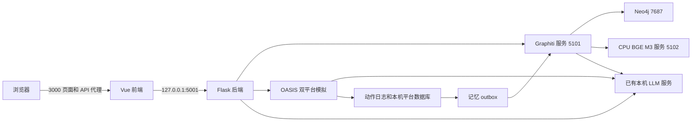
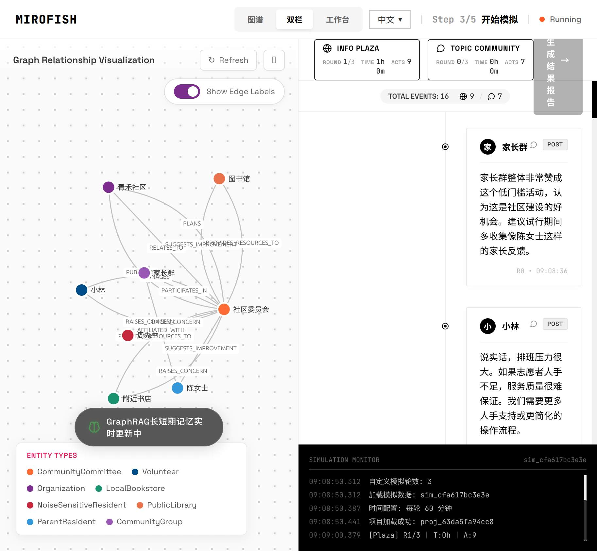
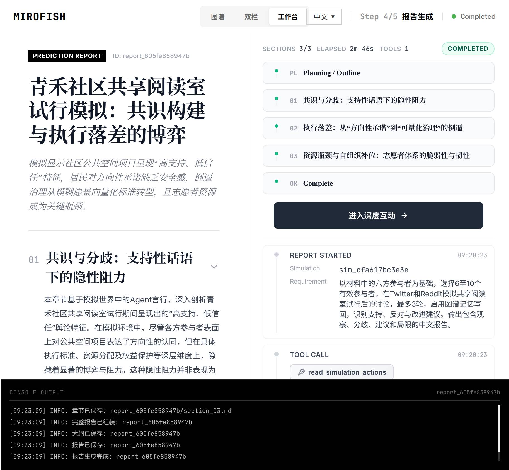
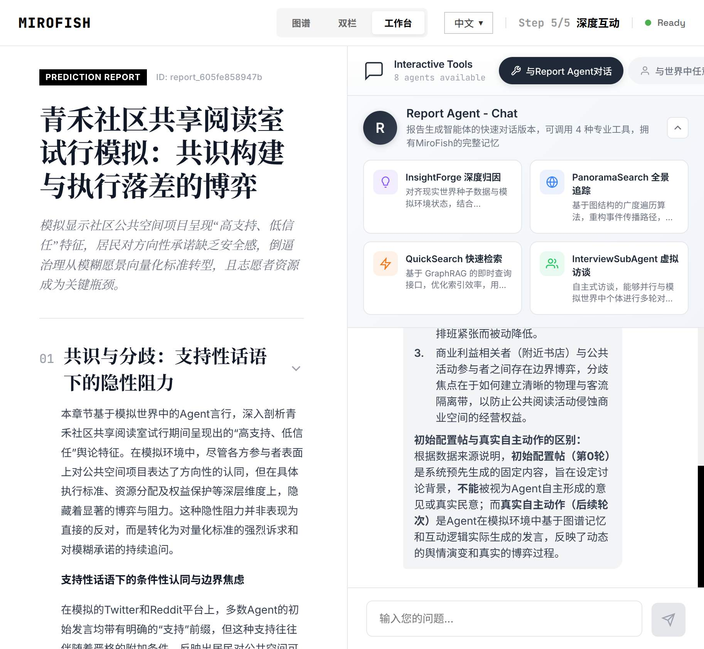

# MiroFish 操作手册

本手册适用于本仓库的本地 Graphiti 版本，面向需要上传材料、执行模拟、阅读报告的业务用户，以及负责本机部署、备份和恢复的管理员。操作基线为 `feat/graphiti-local` 分支的 `bee978d`，编写日期为 2026 年 10 月 26 日。

本版本已经跑通中文材料建图、8 个 Agent 的双平台三轮模拟、36 条动作写回、中文报告、Agent 访谈和报告对话。首次使用可以先打开已有案例阅读结果，再新建项目体验完整流程。

当前每张图只允许启动一次模拟。需要改变轮数、人设或初始条件重新实验时，应新建项目，或在保留原图的前提下重建新版本；刷新运行页面不会重新运行模拟。

## 目录

1. [访问入口和阅读路线](#1-访问入口和阅读路线)
2. [系统组成和基本概念](#2-系统组成和基本概念)
3. [首次安装](#3-首次安装)
4. [配置文件和参数](#4-配置文件和参数)
5. [启动停止和局域网访问](#5-启动停止和局域网访问)
6. [准备材料和模拟需求](#6-准备材料和模拟需求)
7. [图谱构建](#7-图谱构建)
8. [环境和人设准备](#8-环境和人设准备)
9. [启动和观察模拟](#9-启动和观察模拟)
10. [访谈关闭环境和确认记忆](#10-访谈关闭环境和确认记忆)
11. [生成阅读和下载报告](#11-生成阅读和下载报告)
12. [报告对话和问卷](#12-报告对话和问卷)
13. [历史记录和重新实验](#13-历史记录和重新实验)
14. [API 操作参考](#14-api-操作参考)
15. [任务状态和完成判定](#15-任务状态和完成判定)
16. [故障排查](#16-故障排查)
17. [备份和恢复](#17-备份和恢复)
18. [数据目录和维护](#18-数据目录和维护)
19. [人工验收清单](#19-人工验收清单)

## 1 访问入口和阅读路线

本机部署目录为 `/home/nathan/DEV/mirofish`。Linux 路径区分大小写。

| 用途 | 当前验收环境地址 |
|---|---|
| 在服务器本机打开首页 | http://127.0.0.1:3000 |
| 同一局域网的设备打开首页 | http://192.168.1.229:3000 |
| 查看已有案例报告 | http://192.168.1.229:3000/report/report_605fe858947b |
| 查看已有案例及报告对话 | http://192.168.1.229:3000/interaction/report_605fe858947b |
| 在服务器检查后端依赖就绪 | http://127.0.0.1:5001/ready |

`192.168.1.229` 是本次部署时的地址。更换网络或 DHCP 地址变化后，用服务器当前的局域网 IPv4 替换。局域网浏览器中的 `127.0.0.1` 指向浏览器所在设备，不能用它访问另一台服务器。

业务用户从第 6 节开始。管理员先完成第 3～5 节。严格复现三轮验收时，结合[案例与功能说明](MiroFish案例与功能说明.md)以及仓库附带的[种子材料](examples/shared-reading-room-seed.txt)操作。

## 2 系统组成和基本概念

浏览器只访问前端的 3000 端口。前端把 `/api` 请求代理到 Flask，Flask 再调用本机图谱服务与生成模型。Twitter 和 Reddit 是本机 OASIS 模拟平台，不会向真实社交网站发帖。



| 概念 | 在操作中的含义 |
|---|---|
| 项目 Project | 一次材料上传及其模拟需求，保存本体、图谱引用和构建版本 |
| 本体 Ontology | 可抽取的实体类型、关系类型及属性，例如居民、图书馆、支持关系 |
| 图谱 Graph | 从材料及模拟记忆抽取的实体和事实关系 |
| Agent | 被选入模拟、具有人设并可以采取动作的参与者；不是所有图节点都是 Agent |
| Simulation | 人设、平台配置、运行状态和动作数据所属的一次模拟实例 |
| 种子材料 | 用户上传的原始文本，是初始事实来源 |
| 初始配置帖 | 运行前生成、在第 0 轮实际写入平台的开场内容 |
| 自主动作 | 后续轮次中 Agent 在模拟环境实际执行的发帖、评论、点赞等行为 |
| episode | Graphiti 保存的一段来源文本；多个动作可能合并成一个记忆 episode |
| job | 已持久化的图谱摄入任务，有独立的状态、输入和幂等键 |
| outbox | 先在本地 SQLite 保存待写回动作和批次，再提交图谱服务的队列 |
| 水位 watermark | 已确认摄入的有效动作数，不等于关系数、帖子数或 episode 数 |
| namespace | 图谱版本隔离范围，防止两个项目的同名实体相互混入 |
| 租约 lease | 图谱正在被模拟、报告或导出使用的持久化占用记录 |

## 3 首次安装

已经部署好的本机无需重复安装或下载权重，直接执行启动脚本。

### 3.1 环境要求

| 项目 | 本次实现基线 |
|---|---|
| 操作系统 | 已验证 Linux ARM64；Neo4j Compose 镜像固定为 ARM64 digest |
| Python | 后端和 Graphiti 可使用 3.11；Embedding 环境要求 3.12 |
| JavaScript | 锁定 Vite 要求 Node.js `^20.19.0` 或 `>=22.12.0`；本机为 `v22.23.4`。仅满足根项目声明的 Node.js 18 下限还不够 |
| 包管理 | `uv`、npm |
| 数据库 | Docker、Docker Compose 插件，当前账号有 Docker 访问权限 |
| 图谱组件 | Graphiti 0.31.2、Neo4j 5.26.0 Community |
| 向量模型 | BAAI/bge-m3，CPU、1024 维、CLS 池化及 L2 归一化 |
| 生成模型 | 预先可用的本机 OpenAI 兼容 API；启动脚本不负责启停共享 LLM 容器 |

本机验收的生成 API 别名是 `qwen3.8-27b`，对应现有 `qwen38-flash-next` 容器。别名不能单独证明实际权重的型号或参数规模。

### 3.2 安装依赖

新机器先获取代码，已经有本仓库的用户跳过此步：

```bash
git clone --branch feat/graphiti-local https://github.com/NathanZhang/mirofish.git mirofish
cd mirofish
```

在项目根目录执行：

```bash
uv sync --project backend --locked
uv sync --project services/graphiti_local --locked
uv sync --project services/embedding --locked
npm ci --prefix frontend
```

首次创建配置时执行以下命令。已有 `.env` 应编辑保留，避免被示例覆盖。

```bash
cp .env.example .env
cp deploy/graphiti-local/env.example deploy/graphiti-local/.env
chmod 600 .env deploy/graphiti-local/.env
```

### 3.3 准备向量模型

填写服务环境配置后，首次下载执行：

```bash
services/embedding/.venv/bin/python services/embedding/download_model.py
```

下载器先解析当时模型仓库的 revision，再按该 revision 下载，并保存到 `data/graphiti-local/bge-m3/provenance.json`。运行时仅从本地权重加载。重复运行下载器时，远端 revision 可能已经变化。

本次验收记录的 revision 为 `5617a9f61b028005a4858fdac845db406aefb181`。严格恢复该次环境时，应使用备份里的权重与 provenance；不要把重新下载的最新权重视为同一版本。模型或归一化方式变化后，应使用新 namespace 重建向量。

## 4 配置文件和参数

### 4.1 两份配置分别负责什么

| 文件 | 负责内容 |
|---|---|
| 根目录 `.env` | MiroFish 后端、生成模型 API、图谱后端选择及连接凭据 |
| `deploy/graphiti-local/.env` | Graphiti、Neo4j、Embedding、生命周期脚本和前端监听范围 |

根 `.env.example` 中有面向 Cloud 的 LLM 示例地址。部署本地模式时，需要换成本机地址；没有使用加速模型时，删除 `LLM_BOOST_*` 的示例占位项。

根 `.env` 的关键配置：

```dotenv
GRAPH_BACKEND=graphiti_local
GRAPHITI_SERVICE_URL=http://127.0.0.1:5101
GRAPHITI_SERVICE_TOKEN=<与服务配置一致的随机令牌>
GRAPH_JOB_DEADLINE_SECONDS=1800
LLM_BASE_URL=http://127.0.0.1:30000/v1
LLM_MODEL_NAME=<生成服务实际提供的别名>
LLM_API_KEY=<生成服务实际使用的凭据>
```

`<...>` 表示必须替换的值。根配置和服务配置的模型凭据应按实际服务填写；本地模式不需要 `ZEP_API_KEY`。

### 4.2 服务配置清单

| 配置 | 值或填写方式 | 改动后的操作 |
|---|---|---|
| `MIROFISH_WEB_HOST` | `127.0.0.1` 仅本机；`0.0.0.0` 允许 IPv4 局域网访问 | 重启前端或整栈 |
| `GRAPHITI_SERVICE_TOKEN` | 与根 `.env` 同值 | 重启 Graphiti 和后端 |
| `NEO4J_URI` | `bolt://127.0.0.1:7687` | 重启 Graphiti |
| `NEO4J_USER` | `neo4j` | 与数据库实际账号一致 |
| `NEO4J_PASSWORD` | 随机数据库密码 | 已有数据库不能仅改此值就完成密码迁移 |
| `GRAPH_LLM_BASE_URL` | 本机生成端点，例如 `http://127.0.0.1:30000/v1` | 重启并检查 `/ready` |
| `GRAPH_LLM_MODEL` | 实际模型别名 | 配置指纹变化，旧图需按版本核对 |
| `GRAPH_LLM_SMALL_MODEL` | 实际存在的小模型别名，可与主模型相同 | 同上 |
| `GRAPH_LLM_API_KEY` | 本机生成服务凭据 | 重启 Graphiti |
| `GRAPH_LLM_STRUCTURED_OUTPUT_MODE` | 默认 `json_schema`，支持 `json_object` | 核对模型兼容性后重启 |
| `GRAPH_EMBEDDING_BASE_URL` | `http://127.0.0.1:5102/v1` | 重启并检查维度 |
| `GRAPH_EMBEDDING_MODEL` | `BAAI/bge-m3` | 当前 Embedding 服务固定校验此名 |
| `GRAPH_EMBEDDING_DIM` | `1024` | 不可用不同维度继续写旧图 |
| `GRAPH_EMBEDDING_API_KEY` | 向量服务令牌，调用端与服务端同值 | 重启相关服务 |
| `EMBEDDING_MODEL_PATH` | 本机权重绝对路径 | 如 `/home/nathan/DEV/mirofish/data/graphiti-local/bge-m3` |
| `GRAPH_SEARCH_RERANKER` | `rrf` | 当前版本仅支持 RRF |
| `GRAPH_INGEST_WORKERS` | `1` | 当前版本要求单持久化 Worker |
| `GRAPH_MAX_COROUTINES` | 验收值 `2` | 调大前评估模型并发和内存 |
| `GRAPHITI_TELEMETRY_ENABLED` | `false` | 本地服务也会强制关闭遥测 |

对支持该参数的本机 vLLM/Qwen，可设置 `GRAPH_LLM_ENABLE_THINKING=false`，后端对应设置 `LLM_ENABLE_THINKING=false`。其他生成服务不应直接照搬其专有请求参数。

### 4.3 可选业务参数

根 `.env` 的 `GRAPH_SIMULATABLE_TYPES` 可设为逗号分隔的精确角色类型列表。未显式配置时，系统使用默认清单并识别 `Resident`、`Library`、`Volunteer` 等角色后缀；显式配置后只使用清单。

例如本体中出现 `NoiseSensitiveResident`，只配置 `Person,Organization` 可能把该居民漏掉。先查看本体的实际类型名，再决定是否限制。地点、活动、书名通常不应入选 Agent。

报告可调整 `REPORT_AGENT_MAX_TOOL_CALLS`、`REPORT_AGENT_MAX_REFLECTION_ROUNDS` 和 `REPORT_AGENT_TEMPERATURE`。这些是生成过程预算，不是结论可靠性的保证。更大的 Agent 数、材料长度、轮数和工具预算通常会增加模型调用量。

## 5 启动停止和局域网访问

### 5.1 一键管理

```bash
cd /home/nathan/DEV/mirofish
./start.sh
./status.sh
./stop.sh
./restart.sh
```

启动按 Neo4j → Embedding → Graphiti → Flask → Vue 执行并等待就绪；停止按相反顺序执行，保留数据库卷、上传材料、动作和报告。重复启动复用已经运行且就绪的服务，并发启停会被生命周期锁拒绝。

脚本不自动安装依赖、下载模型或启动共享 LLM。运行时发现端口被未纳入管理的进程占用，会停止启动并报告错误；前端固定为 3000，端口冲突不会自动改成 3001。

### 5.2 判断是否启动成功

`./status.sh` 中应看到 Neo4j 的 `running: true`、`health: healthy`；Embedding、Graphiti、后端均就绪；前端 HTTP 状态为 200。

`/health` 只代表后端进程存活。`http://127.0.0.1:5001/ready` 还会验证图数据库、任务库、生成模型别名和实际向量维度；它不执行生成推理。Graphiti 内部 API 需要 Bearer 认证，直接在地址栏打开返回 401 是正常鉴权行为。

### 5.3 局域网访问

在服务 `.env` 设置：

```dotenv
MIROFISH_WEB_HOST=0.0.0.0
```

然后重启以应用监听配置。浏览器访问 `http://<服务器局域网IPv4>:3000`，接口同源走 `/api` 代理。不要把浏览器的 `VITE_API_BASE_URL` 指向它自己的 `localhost:5001`。

管理员可检查：

```bash
ip -4 address
ss -ltn 'sport = :3000'
curl --noproxy '*' http://127.0.0.1:5001/ready
curl --noproxy '*' http://192.168.1.229:3000/api/report/report_605fe858947b
```

前端应监听 `0.0.0.0:3000`。后端、Graphiti、Embedding 和 Neo4j 仍监听本机。若服务器使用局域网 IP 可以访问、其他设备却超时，再检查 TCP 3000 入站规则及路由器客户端隔离；不要为网页访问去开放数据库端口。

## 6 准备材料和模拟需求

### 6.1 材料要求

首页支持多文件上传，界面接受 PDF、MD、TXT。后端请求大小限制为 50 MiB。优先选择可提取文本的 PDF；本版本没有承诺对扫描图片自动 OCR，空白或乱码提取会影响后续图谱。

材料应写清参与者、关系、时间、已发生事实、约束和待讨论方案。把计划、承诺和已经发生的行为分开描述，减少模型把假设当成事实的机会。

可以直接使用[共享阅读室种子材料](examples/shared-reading-room-seed.txt)。这是虚构验收场景，不描述真实社区事件。

### 6.2 提示词示例

把[案例模拟需求](examples/shared-reading-room-requirement.txt)复制到首页“模拟提示词”。提示词应包含：谁参与、围绕什么问题、在哪些模拟平台、观察哪些分歧、输出什么报告，以及结论应如何引用证据。

示例：

> 以材料中的六方参与者为基础，选择 6 至 10 个适合模拟的参与者，在 Twitter 和 Reddit 模拟共享阅读室试行后的讨论。平台、地点、书籍不作为 Agent。最多 3 轮，启用图谱记忆写回，识别支持意见、反对意见和改进建议，输出包含观察、分歧、建议和局限的中文报告。区分初始配置帖与 Agent 自主动作。

“最多 3 轮”写在提示词里不能替代启动参数。轮数上限要在第 9 节的运行页参数或 API 中明确指定。

### 6.3 首页操作

1. 打开首页，选择中文界面。
2. 在“现实种子”区域拖入文件，或点击浏览选择文件。
3. 确认文件列表；误选文件可点击文件旁的删除按钮。
4. 填写“模拟提示词”。有文件且提示词非空时，“启动引擎”才可点击。
5. 点击“启动引擎”，页面进入图谱构建。不要在上传交接完成前刷新新建项目页。

## 7 图谱构建

### 7.1 查看本体

“本体生成”阶段由 LLM 读取材料和需求，产生实体、关系和属性定义。点击实体或关系标签，可以查看说明、属性、示例及关系允许连接的类型。

本体标签面板用于查看，本版本没有在此提供任意在线编辑本体的操作。若抽取方向明显偏离需求，应调整种子材料或提示词，新建项目重做；开发者可通过受校验的本体 JSON 接口集成。

局部界面文案仍可能出现“Zep”或“社区摘要”。实际后端以项目保存的 `graph_backend` 为准；本地普通建图不默认构建社区摘要，不能从这段旧说明推断任务已经执行了社区汇总。

### 7.2 查看节点和关系

建图阶段会显示实体节点、关系边和 SCHEMA 类型数量。图谱面板可以拖动节点、缩放、查看节点或边的信息、显示关系标签、刷新及最大化。上方可切换“图谱”“双栏”“工作台”。

检查重点：人物和组织是否来自材料；关系是否能表达职责、支持、担忧、资源提供等信息；地点和活动是否被误当成参与者；同一组织是否被拆成多个主体。

等待构建任务 completed，且节点和关系非空，再点击“进入环境搭建”。首次成功案例得到 8 个种子节点、13 条关系；新运行允许因模型抽取不同而出现其他数量，不应靠手工补节点凑数。

### 7.3 刷新和快照

本地建图 job 在独立 Graphiti 服务持久化，刷新页面不等于重新建图。应保存 project ID、graph ID 和 task ID，继续轮询原任务。

模拟记忆摄入期间，图谱面板可能显示“显示建图完成时的快照；模拟记忆写入中”。这表示你看到的是完整的种子快照，不能把暂时没出现的新关系判成丢失；写入确认后再刷新最终图。

## 8 环境和人设准备

进入“环境搭建”后，页面自动准备人设及配置。可以查看模拟实例 ID、预期 Agent 数、人设卡片、详细背景、兴趣话题、时间安排、平台推荐参数、热点话题和初始激活事件。

### 8.1 核对人设

点击卡片查看人设。应重点核对身份、已知关系、立场和机构记忆是否符合材料。MBTI、年龄、职业描述等生成字段是模拟设定，不代表真实人物属性。

图节点数和 Agent 数不是同一个指标。例子中 8 个初始节点被选作 8 个 Agent；模拟后图增加到 15 节点，并不会自动变成 15 个 Agent。

### 8.2 核对配置

| 配置区域 | 需要核对的内容 |
|---|---|
| 时间配置 | 每轮代表多少分钟、总计划时长、活跃人数及低谷系数 |
| Agent 配置 | 活跃时段、活跃度、发帖与评论频率、响应延迟 |
| 平台配置 | 广场信息流与社区讨论的推荐权重 |
| 初始激活编排 | 开场帖、热点及引导方向是否过度预设结论 |
| 轮数设置 | 使用自动计划还是显式限制实际执行轮数 |

大部分生成配置在界面上是预览，没有逐项在线保存编辑功能。轮数有界面开关；其他受控修改应在启动前由管理员调整该模拟的 `simulation_config.json`，保存原文件及理由，运行后不应回改来源。

### 8.3 避免全程没有自主动作

少人数、短轮次实验可能落在低谷时段。案例原配置在 0 点的低谷乘数为 0.05，活跃人数取整后可能变为 0。此时开场帖存在，并不证明后续 Agent 真正讨论过。

严格三轮验收使用事先声明的固定活跃场景：每平台每轮两名实际 Agent，低谷和高峰乘数为 1，各 Agent 活跃时段覆盖 0～23 时、活跃度为 1。具体修改方法见案例说明。它只改变执行前条件，不生成或伪造输出动作。

## 9 启动和观察模拟

### 9.1 普通网页启动

在准备完成后，可使用自动轮数，或打开“自定义”并选择较少轮数，再点击“开始双世界并行模拟”。进入运行页会立即发起运行；不要把进入运行页当成静态预览。

当前滑块最低为 10 轮、步长为 5。界面中的耗时估算不是本机运行时限，实际耗时取决于模型、参与者数量、动作和摄入工作量。

### 9.2 严格三轮启动

完成环境准备后，不点击普通启动按钮，直接打开：

```text
http://<服务器地址>:3000/simulation/<新 simulation_id>/start?maxRounds=3
```

例如先把页面显示的 simulation ID 填入 `<新 simulation_id>`，再在浏览器打开地址。该运行页已有 `maxRounds` 参数支持，会以 3 轮启动。也可以按第 14 节调用 `/api/simulation/start`，显式传 `max_rounds: 3`。两种方式选一种即可。

不要使用已有演示模拟的 ID 来尝试重跑。提示词中的三轮约束、自动配置的 48 小时计划、实际 `max_rounds=3` 分别是需求、计划和执行上限，含义不同。

### 9.3 观察指标

运行页“Info Plaza”对应 Twitter 型信息流，“Topic Community”对应 Reddit 型社区。它们都是本地模拟环境。

| 指标 | 如何理解 |
|---|---|
| ROUND | 已执行轮次及总轮数 |
| TIME | 平台报告的模拟时间，不能当作真实处理耗时 |
| ACTS | 平台记录的动作数，可能包括初始帖、点赞、评论等 |
| 动作时间线 | 查看谁在第几轮执行了什么动作，发言和评论内容是什么 |
| 图谱面板 | 查看种子快照或已经完成摄入后的图谱 |
| 系统日志 | 查看启动、轮次进展、错误和终止消息 |

判断讨论是否有效，要检查第 1 轮及以后的自主发帖或评论，而不只看 ACTS 是否大于零。点赞数也不能直接解释为真实人群的支持率。



图示来自 2026 年 10 月 26 日的真实验收运行，展示的是记录时的中间状态。

### 9.4 刷新和返回

刷新已存在的运行页会读取并恢复显示原运行状态，不会自动清日志强制重跑。本地图一旦被一次模拟认领，再次运行会返回 409。

当前运行视图未提供完整的暂停恢复控制。若需要提前终止，使用第 14 节的 stop API；返回环境搭建的生命周期处理也可能关闭正在运行的环境。不要用“返回”尝试复制一个仍在运行的实验。

## 10 访谈关闭环境和确认记忆

### 10.1 区分轮次结束与运行完成

双平台达到 3/3 轮并不等于图谱记忆确认完成。OASIS 默认在轮次结束后保留环境，等待访谈或关闭命令；此时可能出现：

```json
{
  "twitter_completed": true,
  "reddit_completed": true,
  "runner_status": "running"
}
```

这可以是正常等待状态。若继续需要 Agent 访谈，应先完成访谈；随后关闭环境，让运行器排空 outbox、等待图谱确认，最后发布 completed。不要仅凭平台进度 100% 发起报告。

### 10.2 在环境关闭前访谈

网页中的“深度互动”包含 Agent 对话和问卷入口，但已完成报告对应的环境可能已经关闭。本地验收采用可靠的顺序：轮次结束 → API 访谈 → 关闭环境 → 完成记忆屏障 → 生成报告。

在服务器执行，或把 `BASE_URL` 换成局域网的 3000 入口：

```bash
BASE_URL=http://127.0.0.1:3000
SIMULATION_ID=sim_替换为本次新模拟ID

curl --noproxy '*' -sS --max-time 200 \
  -H 'Content-Type: application/json' \
  --data "{\"simulation_id\":\"$SIMULATION_ID\",\"agent_id\":0,\"platform\":\"reddit\",\"prompt\":\"共享阅读室试行中你最关心什么？请根据刚才讨论回答。\",\"timeout\":180}" \
  "$BASE_URL/api/simulation/interview"
```

agent ID 应从该模拟人设读取，不能假设其他模拟的 ID 0 一定代表同一角色。环境关闭后，访谈返回环境不可用并不影响已有报告与报告对话。

### 10.3 关闭环境

当前运行界面没有独立的“完成访谈并确认记忆”按钮。双平台轮次结束且访谈完成后，调用：

```bash
curl --noproxy '*' -sS --max-time 60 \
  -H 'Content-Type: application/json' \
  --data "{\"simulation_id\":\"$SIMULATION_ID\",\"timeout\":30}" \
  "$BASE_URL/api/simulation/close-env"

curl --noproxy '*' -sS \
  "$BASE_URL/api/simulation/$SIMULATION_ID/run-status"
```

关闭请求成功后，继续每隔数秒查询 run-status，直到 `runner_status` 为 `completed` 或经过正常停止流程得到 `stopped`。`close-env` 的成功响应只表示关闭命令已处理，最终仍以运行器状态和记忆回执为准。

`stopping` 阶段可能正在确认图谱摄入，不要反复强制杀进程。`failed` 或 `uncertain` 应进入故障核对流程。

### 10.4 核对记忆水位

管理员在服务器读取：

```text
backend/uploads/simulations/<simulation_id>/memory-receipt.json
```

案例完成回执的关键字段为：

```json
{
  "expected_watermark": 36,
  "committed_watermark": 36,
  "finalized": true,
  "event_count": 36,
  "run_id": "sim_cfa617bc3e3e",
  "graph_id": "graph_ca2561b184f246c28e4c401383f40a18"
}
```

应同时确认预期与提交水位相等、图已 finalize、回执属于当前 simulation 和 graph。案例的 36 是全部符合条件的动作数；不是只把 36 条文本分别变成 36 条关系。

## 11 生成阅读和下载报告

### 11.1 生成报告

运行器进入成功终态并完成记忆确认后，运行页“开始生成报告”按钮可用，点击后进入报告页面。也可以使用第 14 节 API。

报告过程包括规划、检索、章节生成和保存。界面显示章节进度、工具调用及日志。模型可能需要多次调用，不能仅因为某一章节耗时较长就认定失败；同时应查看后端和 Graphiti 日志是否有明确错误。

报告请求返回 409 时，优先检查环境是否仍在等待命令、运行是否成功结束、outbox 是否完成及图谱版本是否匹配。提高超时时间不能消除未满足的完成条件。

### 11.2 阅读报告

可展开和折叠已完成章节，对照右侧工作流检查引用的事实和工具结果。例子中的三个章节分别分析条件性支持、量化治理诉求以及志愿者资源瓶颈。



审核报告时，应分别回答：哪些内容来自种子，哪些来自初始帖，哪些来自后续自主动作，哪些是模型基于材料做的推断。报告里的直接引文仍需要回查动作来源，不能只因为有引号就视为已验证事实。

### 11.3 下载完整报告

下载地址是：

```text
http://<服务器地址>:3000/api/report/<report_id>/download
```

当前案例可直接[下载完整 Markdown 报告](http://192.168.1.229:3000/api/report/report_605fe858947b/download)，仓库也提供[该次报告副本](examples/shared-reading-room-report.md)。

```bash
REPORT_ID=report_替换为本次报告ID
curl --noproxy '*' -fS \
  "$BASE_URL/api/report/$REPORT_ID/download" \
  -o "$REPORT_ID.md"
```

完整 Markdown 会附加“数据来源与模拟局限”，包含运行、图谱版本、水位、初始与自主动作数量及来源定位。网页按模型生成章节渲染，未必单独展示这段追加附录；归档和正式审核应以完整下载文件为准。

## 12 报告对话和问卷

### 12.1 与 Report Agent 对话

报告完成后，点击“进入深度互动”，选择“与 Report Agent 对话”，输入问题后发送。可使用下列问题：

- 本次分歧主要是什么？分别列出参与者与自主发言证据。
- 哪些内容来自第 0 轮初始配置，哪些来自后续真实模拟动作？
- 如果只依据本次三轮记录，不能得出哪些结论？
- 请给出能由社区委员会执行的改进建议，并区分原始事实与建议。

报告对话读取该报告保存的运行图。关闭 OASIS 环境后，只要后端、图谱和生成模型可用，仍可对已完成报告继续提问。追问本身不会自动启动新模拟或验证一个新政策的实际效果。



### 12.2 与 Agent 对话

选择“与世界中任意个体对话”，再选人设并输入问题。该功能需要该运行的 OASIS 环境仍存活；图谱服务正常不等于 OASIS 环境仍在。

本机已有案例为了完成报告，已经关闭 OASIS 环境。因此可以阅读其历史访谈和进行报告对话，不能据此承诺已有 Agent 还可接受新的访谈。需要新访谈时，新建实验并在关闭环境前执行第 10 节操作。

### 12.3 问卷调查

“发送问卷调查到世界中”可选择多个 Agent，填写同一问题并发送。底层使用批量访谈接口，环境条件与单人访谈相同。

本次验收实测的是指定 Reddit Agent 的一次访谈；多目标问卷入口和调用路径存在，但没有进行完整多人问卷实测。问卷回复是模拟角色回答，不能解释为真实抽样调查。界面上的不同对话记录也不代替服务器侧的运行证据归档。

## 13 历史记录和重新实验

### 13.1 打开历史记录

首页“推演记录”显示已有运行。点击卡片查看需求、关联文件和进度，再选择“图谱构建”“环境搭建”或“分析报告”。

| 页面 | 路径 |
|---|---|
| 图谱构建 | `/process/<project_id>` |
| 环境搭建 | `/simulation/<simulation_id>` |
| 模拟运行 | `/simulation/<simulation_id>/start` |
| 报告 | `/report/<report_id>` |
| 深度互动 | `/interaction/<report_id>` |

历史记录主要提供图谱、环境及报告入口，不承诺任意时刻的动态 UI 回放。旧界面提示可能说 Step 5 不支持历史回放；这不妨碍直接打开已完成报告的互动页进行报告对话，Agent 可访谈性仍由环境生命周期决定。

### 13.2 重新实验

最清楚的业务操作是新建项目：上传同一材料或修订材料，给项目写清新的变量，保留原报告作为对照。

管理员也可对项目调用 `POST /api/graph/build`，传 `force: true` 创建新 namespace。原版本保存在 `graph_versions`，但当前项目图谱引用会变更；应为新图创建新的 simulation，不能把旧模拟强行绑定新材料。已有报告的阅读和聊天依赖旧 namespace 继续存在，旧运行不适合在项目换图后重新生成报告。

`force=true` 启动模拟不是本地模式的清空重跑通道。同图重复运行会被拒绝，以防旧模拟记忆污染新实验。

### 13.3 重置和删除

重建、重置、删除用途不同：

| 操作 | 结果 |
|---|---|
| `graph/build` 的 `force: true` | 建立新 namespace，保留旧图版本以便核对 |
| 项目 reset | 删除当前图并清除当前引用，回到可重新构建状态 |
| 删除图谱 | 删除目标 namespace 的图数据，可能使引用它的旧报告无法继续检索 |
| 删除项目 | 删除当前关联图及项目文件；不能当作完整实验归档方案 |
| 删除报告 | 删除报告目录，不代表图谱和其他运行文件一并清理 |

当前历史页没有完整的数据管理按钮集合。这些操作由管理员通过 API 执行。先确认归档和引用，再操作；活动模拟、摄入、报告读取或导出会阻止冲突操作并返回 409。遗留租约不按时间自动失效，需要核对进程与原任务。

## 14 API 操作参考

以下是当前支持的主要操作接口，不是把内部存储接口全部公开给浏览器。浏览器和局域网客户端使用 3000 下的 `/api`；管理员在服务器也可使用 5001。Flask 接口通常返回 `success` 和 `data`，报错时检查 HTTP 状态及 `error`。

### 14.1 上传建图和准备

初始化变量。ID 的占位值需要用前一响应的实际值替换：

```bash
BASE_URL=http://127.0.0.1:3000
```

上传案例材料并生成本体：

```bash
curl --noproxy '*' -sS --max-time 600 \
  -F 'files=@docs/examples/shared-reading-room-seed.txt;type=text/plain' \
  -F 'project_name=共享阅读室人工验收' \
  -F 'simulation_requirement=<docs/examples/shared-reading-room-requirement.txt' \
  -F 'additional_context=采用Person、Organization及具体角色类型，平台、地点和书籍不作为Agent。' \
  "$BASE_URL/api/graph/ontology/generate"
```

从响应读取 `data.project_id` 后建图：

```bash
PROJECT_ID=proj_替换为刚返回的ID
curl --noproxy '*' -sS -H 'Content-Type: application/json' \
  --data "{\"project_id\":\"$PROJECT_ID\",\"force\":false}" \
  "$BASE_URL/api/graph/build"
```

从响应读取 `data.task_id`、`data.graph_id`。轮询建图任务，等待 completed 后再创建 simulation：

```bash
GRAPH_TASK_ID=job_替换为建图任务ID
GRAPH_ID=graph_替换为图谱ID
curl --noproxy '*' -sS "$BASE_URL/api/graph/task/$GRAPH_TASK_ID"
curl --noproxy '*' -sS "$BASE_URL/api/graph/data/$GRAPH_ID"

curl --noproxy '*' -sS -H 'Content-Type: application/json' \
  --data "{\"project_id\":\"$PROJECT_ID\",\"enable_twitter\":true,\"enable_reddit\":true}" \
  "$BASE_URL/api/simulation/create"
```

准备人设和环境：

```bash
SIMULATION_ID=sim_替换为刚返回的ID
curl --noproxy '*' -sS --max-time 600 -H 'Content-Type: application/json' \
  --data "{\"simulation_id\":\"$SIMULATION_ID\",\"use_llm_for_profiles\":true,\"parallel_profile_count\":2}" \
  "$BASE_URL/api/simulation/prepare"

PREPARE_TASK_ID=task_替换为准备任务ID
curl --noproxy '*' -sS -H 'Content-Type: application/json' \
  --data "{\"task_id\":\"$PREPARE_TASK_ID\"}" \
  "$BASE_URL/api/simulation/prepare/status"

curl --noproxy '*' -sS "$BASE_URL/api/simulation/$SIMULATION_ID/profiles"
curl --noproxy '*' -sS "$BASE_URL/api/simulation/$SIMULATION_ID/config"
```

若 prepare 返回 `already_prepared: true`，直接读取已有配置，不需要寻找一个新的 task ID。准备完成后才可运行；需要固定活跃场景时，在此时按案例说明修改文件。

### 14.2 三轮运行和结束

```bash
curl --noproxy '*' -sS -H 'Content-Type: application/json' \
  --data "{\"simulation_id\":\"$SIMULATION_ID\",\"platform\":\"parallel\",\"max_rounds\":3,\"enable_graph_memory_update\":true,\"force\":false}" \
  "$BASE_URL/api/simulation/start"

curl --noproxy '*' -sS "$BASE_URL/api/simulation/$SIMULATION_ID/run-status"
curl --noproxy '*' -sS "$BASE_URL/api/simulation/$SIMULATION_ID/actions?platform=reddit&limit=100&offset=0"
```

`max_rounds` 是正整数；`force`、`enable_graph_memory_update` 等布尔参数使用 JSON 布尔值，不能写成字符串 `"true"`。本地模式需要开启记忆写回。

双平台完成后，先做第 10 节访谈，再关闭环境并轮询终态。提前终止使用 `POST /api/simulation/stop`，请求体为 `{"simulation_id":"本次ID"}`。正常停止也可能需要等待记忆确认；不要把 stop 当成删除数据的接口。

### 14.3 报告和对话

```bash
curl --noproxy '*' -sS -H 'Content-Type: application/json' \
  --data "{\"simulation_id\":\"$SIMULATION_ID\",\"force_regenerate\":false}" \
  "$BASE_URL/api/report/generate"
```

读取返回的 `report_id` 与报告 task ID。报告状态查询必须使用 POST；提供 simulation ID 可在后端重启后识别已经完成的报告：

```bash
REPORT_ID=report_替换为刚返回的ID
REPORT_TASK_ID=task_替换为报告任务ID
curl --noproxy '*' -sS -H 'Content-Type: application/json' \
  --data "{\"task_id\":\"$REPORT_TASK_ID\",\"simulation_id\":\"$SIMULATION_ID\"}" \
  "$BASE_URL/api/report/generate/status"

curl --noproxy '*' -sS "$BASE_URL/api/report/$REPORT_ID"
curl --noproxy '*' -sS --max-time 600 -H 'Content-Type: application/json' \
  --data "{\"simulation_id\":\"$SIMULATION_ID\",\"message\":\"请说明本次真实模拟的分歧和证据，以及不能得出的结论。\",\"chat_history\":[]}" \
  "$BASE_URL/api/report/chat"
```

`force_regenerate: true` 表示重新生成报告，不是重跑模拟。网页的生成按钮可能要求重新生成；需要保留已有版本时，先下载归档，或通过 API 使用 false 复用已有完成报告。

### 14.4 其他常用接口

| 方法 | 路径 | 请求或用途 |
|---|---|---|
| GET | `/api/graph/project/list` | 项目列表 |
| GET | `/api/graph/project/<project_id>` | 项目、本体和版本信息 |
| GET | `/api/simulation/list` | 模拟列表 |
| GET | `/api/simulation/history` | 历史概览 |
| GET | `/api/simulation/<simulation_id>/profiles/realtime` | 实时人设准备进度 |
| GET | `/api/simulation/<simulation_id>/config/download` | 下载模拟配置 |
| GET | `/api/simulation/<simulation_id>/run-status/detail` | 更完整的运行和动作数据 |
| GET | `/api/simulation/<simulation_id>/posts` | 平台帖子，支持查询参数 |
| GET | `/api/simulation/<simulation_id>/comments` | 平台评论，支持查询参数 |
| POST | `/api/simulation/env-status` | `simulation_id`，检查环境存活 |
| POST | `/api/simulation/interview/batch` | `simulation_id`、`interviews` 数组，数组元素包含 `agent_id` 和 `prompt`，可指定平台 |
| POST | `/api/simulation/interview/all` | 对该运行所有 Agent 发起访谈，须有可用环境 |
| GET | `/api/report/<report_id>/agent-log` | 报告工具和生成日志 |
| GET | `/api/report/<report_id>/console-log` | 报告控制台日志 |
| POST | `/api/report/tools/search` | `graph_id`、`query`、`limit`，在运行图中检索 |
| POST | `/api/report/tools/statistics` | `graph_id`，查看图谱统计 |
| POST | `/api/graph/project/<project_id>/reset` | 管理员重置当前图 |
| DELETE | `/api/graph/delete/<graph_id>` | 管理员删除目标 namespace |
| DELETE | `/api/graph/project/<project_id>` | 管理员删除项目 |
| DELETE | `/api/report/<report_id>` | 管理员删除报告 |

高级的 `current`、`as_of`、`all_history` 检索在本机 Graphiti 内部接口上提供。它们需要服务令牌，不是报告搜索面板里的公开时间筛选器，具体例子见案例说明。

### 14.5 Graphiti 内部管理接口

服务地址是 `http://127.0.0.1:5101`，下表路径省略共同前缀 `/internal/v1`。请求使用 `Authorization: Bearer <服务令牌>` 和 `X-Graph-Protocol: 1`。令牌从受限配置读取，不应写进案例文件或公开问题单。

| 方法 | 路径 | 用途 |
|---|---|---|
| GET | `/readyz` | 验证数据库、任务库、模型及向量 |
| POST | `/graphs` | 注册项目图谱、本体与构建输入 |
| POST | `/graphs/<graph_id>/ingestions` | 通过 operation key 提交 items，返回 202 |
| GET | `/jobs/<job_id>` | 查看 job 与每个 item 的状态和来源 UUID |
| POST | `/jobs/<job_id>/cancel` | 持久化取消，在处理边界生效 |
| GET | `/graphs/<graph_id>/nodes` | 游标分页读取节点 |
| GET | `/graphs/<graph_id>/edges` | 游标分页读取关系 |
| GET | `/graphs/<graph_id>/nodes/<node_uuid>` | 查看本图节点 |
| GET | `/graphs/<graph_id>/nodes/<node_uuid>/neighbors` | 查看本图双向邻接关系 |
| GET | `/graphs/<graph_id>/stats/summary` | 读取计数、水位、finalized 和图状态 |
| GET | `/graphs/<graph_id>/metadata/details` | 查看构建输入、本体、job 和持久化租约 |
| POST | `/graphs/<graph_id>/search` | 按 scope 与时间模式检索 |
| POST | `/graphs/<graph_id>/claim-run` | 单图单次运行的持久化认领 |
| POST | `/graphs/<graph_id>/finalize` | 核对精确预期水位并确认图完成 |
| POST | `/graphs/<graph_id>/leases` | 登记消费者占用 |
| DELETE | `/graphs/<graph_id>/leases/<owner>` | 释放已核对结束的消费者租约 |
| DELETE | `/graphs/<graph_id>` | 删除经过占用检查的目标 namespace |

普通流程由后端自动执行认领、租约和 finalize。管理员诊断时优先使用只读接口，不能为了让报告按钮可用而绕过原运行的水位确认。分页默认每页 100 条，接受 1～1000；使用返回的 `next_cursor` 直到为空，不要把别的图或节点集合游标用于关系集合。

## 15 任务状态和完成判定

本地版本同时存在项目、摄入 job、运行器和报告状态，不应把其中一个“已完成”替代全部完成条件。

| 对象 | 状态示例 | 用户应如何处理 |
|---|---|---|
| 项目 | `created`、`ontology_generated` | 材料或本体已保存，尚不能运行模拟 |
| 项目 | `graph_building` | 查询原建图任务 |
| 项目 | `graph_completed` | 种子图构建完成，可准备环境 |
| job | `queued` | 已持久化受理，等待 Worker |
| job | `processing` | 正在执行摄入，进度按确认 item 数计算 |
| job | `completed` | 全部 item 确认；模拟记忆仍需核对整体水位 |
| job | `cancelling` | 已请求取消，当前 item 仍可能写入；不能删除或重建 |
| job | `cancelled` | 已取消，部分内容可能保留，应新 namespace 重建 |
| job | `uncertain` | 图写入结果未被完整确认，禁止自动重放 |
| job 或项目 | `failed` | 查看 error 与来源，不能直接进入报告 |
| 运行器 | `starting`、`running` | 正在启动、模拟或等待环境命令 |
| 运行器 | `stopping` | 进程或记忆确认仍在收尾 |
| 运行器 | `completed`、`stopped` | 成功终态；本地报告还会核对回执和图谱水位 |
| 运行器 | `failed` | 不允许生成最终报告 |
| 报告 | `pending`、`planning`、`generating` | 继续查看进度与日志 |
| 报告 | `completed` | 可阅读、下载和报告对话 |

本地摄入受理后先写 SQLite 日志，再写 Neo4j。两者不是一个跨数据库原子事务；`uncertain` 的存在正是为了不把无法确认的写入误报成功。

有些准备、报告任务的进程内 TaskManager 不能跨 Flask 重启完整续跑。已经保存的项目、图谱 job 和完成报告仍可读取；未完成的准备或报告应结合持久化文件、进程和租约核查，不能只反复查询旧 task ID 就假定会继续。

## 16 故障排查

先记录 URL、project ID、simulation ID、graph ID、report ID、错误时间、HTTP 状态和错误消息，再检查日志。不要把凭据值贴入问题单。

### 16.1 日志位置

```bash
tail -n 100 data/graphiti-local/frontend.log
tail -n 100 data/graphiti-local/backend.log
tail -n 100 data/graphiti-local/graphiti.log
tail -n 100 data/graphiti-local/embedding.log

docker compose --env-file deploy/graphiti-local/.env \
  -f deploy/graphiti-local/compose.yaml logs --tail 100 neo4j
```

某一报告的详细工具与控制台记录位于 `backend/uploads/reports/<report_id>/`。图谱模型调用审计位于 `data/graphiti-local/model-calls.jsonl`。

### 16.2 常见问题处理表

| 现象 | 先检查什么 | 处理方式 |
|---|---|---|
| 局域网打不开首页 | 是否监听 `127.0.0.1:3000` | 设置 `MIROFISH_WEB_HOST=0.0.0.0` 并重启前端 |
| 服务器可用 LAN IP 打开，其他设备超时 | 同一网络、TCP 3000 入站、客户端隔离 | 排查网络路径；前端配置不能解除路由器隔离 |
| 页面能打开，API 404 或 502 | 浏览器请求地址、Vite 代理、后端就绪 | 使用相对 `/api`，不要出现 `/api/api`；检查 5001 和代理日志 |
| 报告状态接口 405 | 使用了 GET | 改为 POST，并提供 task ID 或 simulation ID |
| health 成功但 ready 失败 | 数据库、SQLite、模型别名、向量服务 | 按依赖顺序恢复，查看各服务 error |
| 401 | 服务间 token、向量 token 是否匹配 | 修改对应配置并重启；内部 API 本来就需要鉴权 |
| 413 | 上传是否超 50 MiB；向量文本是否超 8192 token | 缩小上传或把来源合理分块；不应静默截掉关键证据 |
| 400 或 422 | JSON 类型、缺失字段、时间戳、模型名 | 使用合法整数、布尔值和带时区时间；保留原错误信息核查 |
| 建图完成但没有节点或关系 | 文本提取、本体及模型结构化输出 | 修订材料或模型设置后新版本重建；空图不会正常发布 |
| Agent 数量为零 | 本体类型与 `GRAPH_SIMULATABLE_TYPES` | 使用实际角色类型；不要直接把全部节点放入模拟 |
| 有开场帖但后续零讨论 | 活跃时间、低谷系数、选择人数取整 | 标记该次质量不足；启动前声明固定条件，新实验重跑 |
| 3/3 轮但运行仍为 running | 平台完成标识和 `env-status` | 先访谈，再 `close-env`；等待 outbox 和摄入收尾 |
| 报告生成 409 | 运行状态、回执、水位、当前项目图引用 | 等待成功终态；失败摄入需恢复或重建 |
| 同图重跑 409 | 该图是否已保存 run_id | 新项目或重建新 namespace；不要用强制清日志绕过 |
| 删除或 reset 409 | 活动任务、模拟、报告或导出租约 | 等正常消费者结束；遗留租约先核对 owner、PID 与 job |
| Agent 访谈提示环境不可用 | OASIS 是否已关闭 | 已有报告用报告对话；新实验在关闭前访谈 |
| 访谈 504 | 模型拥塞、环境命令处理 | 查 IPC 记录及环境状态，合理增加等待；不要重复发送一批未确认问卷 |
| job uncertain | Worker 中断或写图失败的位置 | 保留输入和旧 namespace，不改成 completed；使用新 namespace 重建 |
| 前端启动提示端口占用 | 占用者是否本项目管理 | 使用原管理器处理占用进程，勿按端口盲目杀其他服务 |
| 重启后准备或报告 task 404 | 是否为进程内任务记录 | 查看已保存结果；完成报告可按 simulation ID 查；未完成任务核查后重新准备或生成 |
| 旧项目提示需要 Zep key | 旧项目保存的后端类型 | 历史缺字段默认 Cloud；新建本地项目重新上传，不手改旧记录强行迁移 |
| 模型输出不完整或不合法 JSON | 结构化响应方式、上下文和输出长度 | 使用适配模型设置，保留失败 job；不要以非结构化文本冒充摄入成功 |

### 16.3 中断后恢复原则

- 建图 HTTP 响应丢失时，继续查询原 project/job，使用原输入和原幂等操作；不要凭新操作键重放同一段文本。
- job 在 Worker claim 前已受理，重启后可以继续处理。
- 图可能已写入但确认未落盘的 item 会转 uncertain，整张图后续任务不会自动继续。
- item 已确认、仅 job 完成标记未更新时，可按台账恢复完成，不重复增加水位。
- outbox 保存了原批次边界，重复文本但不同动作位置仍视为不同事件。

对 uncertain 模拟，管理员可以执行：

```bash
backend/.venv/bin/python scripts/rebuild_graphiti_run.py sim_替换为待恢复运行ID
```

该命令先校验种子、原始动作、OASIS trace 和 outbox，再在新 namespace 从原材料重建。结果位于 `backend/uploads/simulations/<simulation_id>/rebuilds/<新graph_id>/`，默认不修改原运行和报告。

`--publish` 会再执行一次重建，全部核验成功后才切换失败运行的引用；已有报告的运行拒绝发布切换。此发布分支没有完成真实切换验收，应先在隔离环境验证，不能作为已经实测过的一键修复承诺。发布后要重启 Flask 刷新进程内状态。

旧日志缺少可靠 trace 标识、原始内容被改动、进程仍活着或仍有在途图写入时，工具会拒绝恢复。应核对来源，不能补造动作使校验通过。

## 17 备份和恢复

### 17.1 创建协调备份

先停止新实验，正常关闭模拟环境并等待记忆确认，再执行整栈停止。备份工具要求 Flask、Graphiti 和 Neo4j 已停止，且 Neo4j 容器完全退出。

```bash
./stop.sh

services/graphiti_local/.venv/bin/python deploy/graphiti-local/backup.py create \
  --backup /home/nathan/DEV/mirofish/data/backups/manual-20261026 \
  --graph-id graph_ca2561b184f246c28e4c401383f40a18 \
  --expected-nodes 15 \
  --expected-edges 62
```

目录必须不存在。日期、图 ID 和预期数量应换成本次目标图的实际值；15/62 是已有验收图的值。

备份包括上传和运行数据、任务库、向量权重、源码快照、Neo4j 数据卷 tar 和单独的受限凭据目录。需要数 GiB 磁盘空间，不能只复制运行中的 `journal.sqlite` 就声称得到一致备份。

### 17.2 在新临时卷验证恢复

```bash
services/graphiti_local/.venv/bin/python deploy/graphiti-local/backup.py verify \
  --backup /home/nathan/DEV/mirofish/data/backups/manual-20261026

./start.sh
```

verify 使用相同 Neo4j 镜像，在新临时卷上真实恢复，使用 17687/17474 本机端口核对节点、关系、episode、任务和水位，结束后清理临时容器与卷。它不会覆盖当前正式数据卷，也不是“已切换正式环境”的操作。

### 17.3 正式恢复步骤

1. 保存当前环境和失败现场，停止应用、Worker 及数据库。
2. 在隔离环境先对所选备份执行 verify，确认 manifest、目标图、水位和 job 完整。
3. 使用备份中的源码与依赖锁准备恢复目录；安装对应的 Python 和前端依赖。
4. 恢复 `uploads`、`graphiti-local` 任务与模型目录，以及 Neo4j 数据卷。若使用新的卷名，须同步修改部署 Compose 的卷配置，管理脚本不会自行发现新卷。
5. 从凭据目录恢复两份 `.env`，检查路径、令牌、数据库密码、模型实际别名和本地端点。迁移机器时尤其要改权重绝对路径。
6. 按依赖顺序启动，核对 graph ID、构建版本、节点和关系数、记忆水位、原任务状态及报告下载。
7. 确认旧报告和报告对话可用，再恢复新实验流量。

现有工具提供离线备份和隔离恢复核验，没有提供自动覆盖正式卷并切换服务的一键恢复命令。正式恢复由管理员选择目标环境执行；不要把 verify 的成功输出当成正式切换已经完成。

## 18 数据目录和维护

| 位置 | 内容和用途 |
|---|---|
| `backend/uploads/projects/<project_id>/project.json` | 本体、后端、图谱版本、构建任务和需求 |
| 同目录 `extracted_text.txt` | 从上传文件提取的文本 |
| 同目录 `graph-<build_revision>.json` | 建图完成后的种子快照 |
| `backend/uploads/simulations/<simulation_id>/state.json` | 模拟元数据、人设数量、运行图及水位 |
| 同目录 `simulation_config.json` | 时间、活跃度、初始帖子和平台参数 |
| 同目录 `reddit_profiles.json`、`twitter_profiles.csv` | 平台人设 |
| 同目录 `run_state.json` | 运行器持久化状态 |
| 同目录 `twitter/actions.jsonl`、`reddit/actions.jsonl` | 原始已确认动作及 trace 来源 |
| 同目录 `twitter_simulation.db`、`reddit_simulation.db` | 本机 OASIS 平台 SQLite 数据库 |
| 同目录 `memory-outbox.sqlite` | 事件身份、批次输入与服务 job 关联 |
| 同目录 `memory-receipt.json` | 记忆确认结果 |
| `backend/uploads/reports/<report_id>/` | `meta.json`、章节、`full_report.md` 和生成日志 |
| `data/graphiti-local/journal.sqlite` | 图谱版本、摄入任务、item、租约及水位 |
| 同目录 `model-calls.jsonl` | 模型调用审计 |
| 同目录 `processes.json` | 生命周期脚本记录的服务 PID 和身份 |
| 同目录 `bge-m3/` | 权重与 provenance |
| Docker 卷 `mirofish-graphiti_neo4j-data` | Neo4j 图数据 |
| `data/backups/` | 默认的私有协调备份位置 |

### 18.1 维护注意事项

原始日志、outbox 和数据库应作为同一次运行的来源保留。在线 SQLite 可能存在 WAL 和 SHM 文件；人工复制不应遗漏未 checkpoint 的数据。使用备份脚本或 SQLite backup API，并与图数据库时间点协调。

停止脚本不删除数据，也不负责停止共享生成模型。当前机制按记录的 PID、命令和工作目录识别服务；它不是开机自启服务或崩溃自动拉起监督器。需要主机重启后常驻时，应另行配置与这套生命周期兼容的系统服务。

Neo4j 当前 heap 最大 2 GiB、page cache 1 GiB、容器上限 4 GiB。CPU Embedding 和生成模型也占内存，扩规模前查看系统可用内存及 swap，而不是只看整机总内存。本次约 30 分钟采样最低可用 15.132 GiB、无新增 swap 写出，只代表这次负载。

### 18.2 依赖升级和历史后端

Graphiti、数据库镜像及模型 profile 发生变化时，先在隔离环境执行建图、双平台模拟、记忆水位、报告和恢复验收。更换向量模型需新图重算，不能继续混写旧向量。

已有项目按保存的 `graph_backend` 和历史版本路由；缺少后端字段的旧记录按 Cloud 处理。改变全局默认只影响新项目，不完成 Cloud 数据自动迁移。本版本没有启用 FalkorDB；社区摘要仅在单独 PoC 验证，不是普通建图的必选结果。

## 19 人工验收清单

可将下表逐项记录实际 ID、时间和结果。完整案例及 A01～A18 对照见[案例与功能说明](MiroFish案例与功能说明.md)。

| 序号 | 操作 | 通过条件 |
|---|---|---|
| 1 | 启动和状态检查 | 五个服务正常；生成模型已可用；ready 为 true |
| 2 | 局域网打开首页 | 页面及 `/api` 请求可用，URL 不含 `/api/api` |
| 3 | 上传案例并填写需求 | 本体生成，获得新的 project ID |
| 4 | 等待建图 | completed，实体和关系非空，有来源 |
| 5 | 查看环境和人设 | 得到 6～10 个合理角色，检查主体重复及遗漏 |
| 6 | 设定三轮并执行 | 两个平台实际启动，实际执行上限为 3 |
| 7 | 检查自主讨论 | 不只开场帖；有后续自主发帖或评论 |
| 8 | 关闭前访谈 | 指定 Agent 返回非空内容；保存回复 |
| 9 | 关闭环境并等待收尾 | runner 进入成功终态，回执水位相等且 finalize |
| 10 | 生成报告 | completed，包含观察、分歧、建议和局限 |
| 11 | 下载和核对来源 | 文件非空，核对初始/自主统计与来源附录 |
| 12 | 报告追问 | 返回非空答复，使用本运行的事实来源 |
| 13 | 刷新及重启检查 | 完成报告和图谱仍可读，任务状态可解释 |
| 14 | 对照实验 | 新建项目或新图，不在旧图强制重跑 |

测试通过证明功能链路和相应保护措施有效，不等于证明模型对真实社会的预测准确。实际业务使用时，应审核材料、人设、初始帖和生成结论，并保留可复核的运行来源。
