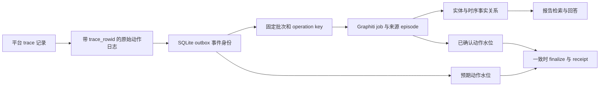

# MiroFish 案例与功能说明

本文以“青禾社区周末共享阅读室”为完整案例，说明本地 Graphiti 版本的功能、输入输出、实际运行结果和验收方法。业务操作步骤见[操作手册](MiroFish操作手册.md)。基线为 `feat/graphiti-local` 分支 `bee978d`，验收日期为 2026 年 10 月 26 日。

案例使用虚构材料。这里的“实际动作”表示 OASIS 模拟数据库确实落库的行为；不表示真实社区发生了相同事件，也不表示模型生成的角色观点就是原始材料中的事实。

## 目录

1. [案例目标和材料](#1-案例目标和材料)
2. [真实运行结果](#2-真实运行结果)
3. [材料上传与本体生成](#3-材料上传与本体生成)
4. [图谱构建与浏览](#4-图谱构建与浏览)
5. [人设与环境配置](#5-人设与环境配置)
6. [双平台模拟与动作记录](#6-双平台模拟与动作记录)
7. [动态记忆与来源追溯](#7-动态记忆与来源追溯)
8. [时间检索与矛盾事实](#8-时间检索与矛盾事实)
9. [报告生成与检索工具](#9-报告生成与检索工具)
10. [报告对话与 Agent 访谈](#10-报告对话与-agent-访谈)
11. [历史版本与项目隔离](#11-历史版本与项目隔离)
12. [失败中断与幂等处理](#12-失败中断与幂等处理)
13. [重建与备份恢复](#13-重建与备份恢复)
14. [案例复现步骤](#14-案例复现步骤)
15. [功能验证矩阵](#15-功能验证矩阵)
16. [人工审核与对照实验](#16-人工审核与对照实验)
17. [证据文件和测试索引](#17-证据文件和测试索引)

## 1 案例目标和材料

### 1.1 待分析的问题

青禾社区准备试行周末共享阅读室。各方普遍愿意支持阅读活动，但可能在开放时间、噪声、志愿者供给、预约规则和商业空间边界上发生分歧。模拟要观察这些角色如何表达诉求、回应他人及提出改进建议。

目标是形成包含观察、分歧、建议和局限的中文报告，并能追溯本次模拟的具体动作。目标不是估算真实社区的支持率。

### 1.2 原始种子

[可上传的完整种子材料](examples/shared-reading-room-seed.txt)包含下列约束：

| 原始参与方或信息 | 材料中的明确内容 |
|---|---|
| 社区委员会 | 提供场地和基本管理，公布预约、噪声约束与反馈渠道 |
| 图书馆 | 提供 300 本图书和借阅支持，建议每周收集阅读兴趣 |
| 志愿者小林 | 负责排班，担心人手不足 |
| 居民陈女士 | 希望增加亲子阅读活动 |
| 居民周先生 | 关注晚间噪声 |
| 附近书店 | 愿意赞助读书会，但不希望影响正常营业 |
| 家长群 | 赞成低门槛活动，是材料明确提到的群体 |
| 开放安排 | 试行第一周周六下午和周日上午，每次最多 20 人，免费预约 |

需求以“六方参与者”为基础，但材料另外提到了家长群和社区主体；不能把“六方”理解为系统必定产生恰好六个节点或六个 Agent。实际应审核抽取主体是否重叠。

### 1.3 模拟需求

使用[可复制需求文本](examples/shared-reading-room-requirement.txt)，限定 6～10 个有效参与者、双平台、最多三轮、记忆写回和中文报告。严格轮数由启动参数保证，不能只依靠提示词。

## 2 真实运行结果

### 2.1 运行身份

这些 ID 只对应已完成的演示运行，用于查阅和核对。重新实验会生成新 ID。

| 对象 | 验收记录 |
|---|---|
| Project | `proj_63da5fa94cc8` |
| Graph | `graph_ca2561b184f246c28e4c401383f40a18` |
| 构建版本 | `mf_9a1ecedf2ad6487f9fcb46e1244fbbc2` |
| 种子摄入 job | `job_233a0dcf3e1247d3ba42cac93a76d0c8` |
| Simulation 与 run_id | `sim_cfa617bc3e3e` |
| Report | `report_605fe858947b` |

[查看当前局域网报告](http://192.168.1.229:3000/report/report_605fe858947b)与[报告对话页](http://192.168.1.229:3000/interaction/report_605fe858947b)。地址依赖当前部署 IP；仓库保留了[完整报告副本](examples/shared-reading-room-report.md)和[机器可读结果](examples/shared-reading-room-result.json)。

### 2.2 数量核对

| 指标 | 结果 |
|---|---:|
| 模拟参与者 | 8 |
| 每个平台执行轮数 | 3 |
| 种子图节点 / 关系 | 8 / 13 |
| 模拟后节点 / 关系 | 15 / 62 |
| 种子 job | 1 |
| 模拟记忆 job | 5 |
| 最终 episode | 6 |
| 符合写回条件的动作 | 36 |
| 完成水位 | 36 / 36 |
| 自主发言 | 12 条，其中 Twitter 发帖 6、Reddit 评论 6 |
| 自主动作 | 22 条，包含上述 12 条发言及 10 次点赞 |
| 初始配置动作 | 14 条，均为初始帖 |
| 完整报告大小 | 20008 字节 |

20 条帖子、6 条评论和 10 次点赞合计 36 条动作。不能把它们统称为“36 条自主讨论”。

### 2.3 结果质量的三个层次

功能完成方面，双平台、记忆、报告、访谈、报告聊天和恢复检查均产生真实输出。模拟质量方面，存在跨轮评论与回应，超过了“只发布初始帖”的最低情况。业务解释方面，材料抽取有主体重叠、生成内容有扩展，报告仍需人工审读。

## 3 材料上传与本体生成

### 3.1 功能用途

把非结构化材料转成允许抽取的实体和关系类型，供后续建图和角色选择使用。输入是文件、模拟需求及可选补充上下文；输出是 project ID、本体、分析摘要和提取文本。

首页支持多份 PDF、MD、TXT。生成本体接口为 `POST /api/graph/ontology/generate`。材料和本体保存到项目目录，后续步骤使用 project ID，不需要浏览器每次重复传全文。

### 3.2 案例中的类型设计

相关角色包括委员会、志愿者、居民、图书馆、书店和家长群，关系表达职责、担忧、支持和资源提供。具体类型名由本体生成决定，可能出现 `CommunityCommittee`、`Volunteer`、`NoiseSensitiveResident`、`PublicLibrary` 等。

本地转换器接受本体 JSON，使用结构化模型定义属性及关系允许连接的类型；不通过执行模型返回的 Python 代码构造本体。保留字段或可执行样式字段会被拒绝，未知端点和重复类型也会被拒绝。

### 3.3 如何验证

1. 上传种子后查看实体与关系标签及属性说明。
2. 确认居民、书店、图书馆的角色方向符合原文。
3. 检查活动、地点、书名与参与者角色有没有混淆。
4. 检查关系类型能表达支持、担忧和职责，而不只是无意义的泛化连线。

属性类型和端点校验见[本体单元测试](../services/graphiti_local/tests/test_ontology.py)。例如整数属性会按模型规则解析，`uuid`、`fact`、`__class__` 等保留或不合法字段不会进入动态本体。

## 4 图谱构建与浏览

### 4.1 功能用途

把种子文本分块后，调用本机生成模型抽取实体和事实，通过 CPU BGE-M3 编码，再写入 Neo4j。来源文本、构建版本和摄入 job 独立保存，避免页面刷新导致材料重复摄入。

案例建图完成后有 8 个节点和 13 条关系。只有摄入确认、节点关系非空、关系带来源、全量读取和检索检查通过，项目才发布为图谱完成。

### 4.2 页面中的对象

| 对象 | 可以做什么 | 应注意什么 |
|---|---|---|
| 实体节点 | 查看名称、类型、摘要和属性 | 模型摘要可能含推断，需要对照来源 |
| 关系边 | 查看关系名、事实、时间和 episode 来源 | 同一实体可能有多条不同时点的事实 |
| 类型图例 | 理解角色分类 | 类型数量不是 Agent 数量 |
| 图谱刷新 | 获取最新完整版本 | 摄入中可能看到有标识的种子快照 |
| 关系标签 | 辅助阅读节点之间的关系 | 过多标签可能拥挤，可切换显示 |

### 4.3 全量分页功能

浏览完整图谱不能只读取第一页。查询层按稳定 UUID 游标分页，并把游标绑定到 namespace 和集合；导出还会核对总数，检测重复 UUID 和游标不前进。

该能力在实际 Neo4j 中用独立合成数据验证：251 个节点、250 条关系，节点与关系各跨 3 页，无重复遗漏。它是分页工程验收，不是共享阅读室业务数据的规模，也不是大规模性能压测结论。

### 4.4 来源与运行图的关系

首期采用单图单次模拟方案。来源图和运行图的 ID 相同，初始图会追加模拟事实；同时保存种子快照与版本元数据。这不同于每次都克隆不可变种子图。

模拟后 15 节点、62 关系说明模拟内容被抽取进图，不能解释成出现了 15 个有效社会参与者。模型生成的书名或新名字也可能成为图节点。

## 5 人设与环境配置

### 5.1 功能用途

依据适合模拟的实体、关系上下文和需求，生成两种平台所需的人设及执行配置。人设除了身份，还可能包含表达风格、兴趣、机构记忆、立场和社交关系。

本地模式不因没有 Cloud 密钥而跳过图谱上下文。角色筛选由实际实体类型和后缀规则完成；用户显式配置类型清单时，清单会替代后缀匹配。

### 5.2 本次八个人设

| Agent ID | 案例名称 | 在本次人设中的主要角色 |
|---:|---|---|
| 0 | 社区委员会 | 公共事务管理与协调 |
| 1 | 小林 | 志愿者协调与排班 |
| 2 | 青禾社区 | 社区公共服务与治理 |
| 3 | 附近书店 | 书店经营与文化传播 |
| 4 | 周先生 | 关注噪声的居民代表 |
| 5 | 图书馆 | 公共图书馆与借阅支持 |
| 6 | 陈女士 | 家长代表与亲子阅读倡导者 |
| 7 | 家长群 | 家长互助及亲子活动协调 |

“社区委员会”和“青禾社区”的人设有明显主体重叠。本次它们是两个被实际运行的 Agent，因此计数为 8；业务解释不能把它们自动当成两个完全独立的利益主体。更严格的实验应先规范命名或修订材料，重新建图检查去重结果。

### 5.3 时间和活跃配置

本次原计划为 48 小时、每轮 60 分钟。实际启动另设 `max_rounds=3`，所以并没有跑满 48 小时计划。运行状态里某些模拟时间字段在该次记录中仍为 0，轮次和动作来源是实际执行的主要核对依据。

原生成配置低谷系数 0.05 可能使零点没有活跃者，因此在运行前声明固定活跃场景：

| 字段 | 三轮验收使用值 |
|---|---|
| `agents_per_hour_min` / `max` | 2 / 2 |
| `off_peak_activity_multiplier` | 1 |
| `peak_activity_multiplier` | 1 |
| 每个 Agent 的 `active_hours` | 0～23 |
| 每个 Agent 的 `activity_level` | 1 |

“每平台每轮选两名 Agent”不等于“每个平台只记录两条动作”。社区平台的 Agent 一次可能执行点赞、评论等多个动作。

### 5.4 初始编排的影响

初始帖子是模型根据角色与需求生成的开场条件。它们会影响后续讨论方向，因此正式分析应记录原配置。看到某个角色的初始帖表示反对，不能据此声称该角色在后续自主讨论中被说服或立场发生变化；需要跨轮动作证明。

## 6 双平台模拟与动作记录

### 6.1 功能用途

在本机分别运行 Twitter 型广场信息流和 Reddit 型话题社区，观察相同人设在不同互动结构下的行为。界面名称分别为 Info Plaza 与 Topic Community，不连接真实平台账号。

两个平台并行执行，轮次和动作分别记录。角色可能发帖、评论、点赞或采取其他配置允许的动作；某种动作被允许，不代表这次实际执行过。

### 6.2 真实动作统计

| 平台 | 初始配置 | 自主发帖 | 自主评论 | 自主点赞 | 总动作 |
|---|---:|---:|---:|---:|---:|
| Twitter | 7 | 6 | 0 | 0 | 13 |
| Reddit | 7 | 0 | 6 | 10 | 23 |
| 合计 | 14 | 6 | 6 | 10 | 36 |

八个 Agent 不要求每人都有一条初始帖；本次每个平台实际成功落库的初始帖子都是 7 条。不能把生成计划中的帖子数量直接当作实际动作数。


### 6.3 日志如何保证是真正执行过的动作

运行脚本先执行 OASIS 操作，再从平台 SQLite 的 `trace` 表读取确认记录，写入 `actions.jsonl`，同时带上 `source_record.trace_rowid`。

此前“按计划先记动作”的问题已改为按数据库确认记录记账，也避免同一初始帖在第一轮被再次记入。相同作者的多条初始帖不会因为按作者建字典而相互覆盖。

| 平台 | trace 总记录 | 进入动作日志 | 其余记录 |
|---|---:|---:|---|
| Twitter | 21 | 13 | 注册 8 |
| Reddit | 38 | 23 | 注册 8、刷新 6、结束后访谈 1 |

注册、刷新是平台内部操作，访谈在本次模拟日志结尾之后发生；这三类不应被硬凑进 36 条模拟记忆水位。原始 JSONL 保留来源字段，而通用 actions API 的展示 DTO 不一定返回全部 trace 元数据；精确核对须使用原始文件。

### 6.4 三条可以复查的自主发言

以下为真实模拟日志的节选，均属于 Agent 生成内容：

| 平台与位置 | 发言节选 | 观察意义 |
|---|---|---|
| Twitter 第 1 轮，“青禾社区”，trace 16 | “我们将在公共空间管理与志愿服务支持下，试行开放时间、图书借阅、预约登记和安静使用规则，并收集大家的意见反馈。” | 发布运行说明和反馈安排 |
| Reddit 第 1 轮，小林，trace 21 | “目前排班中已专门安排了志愿者负责秩序维护和噪声监控……后续也会配合社区委员会公布具体的静音规则。” | 回应噪声顾虑，但部分内容是模拟扩展 |
| Reddit 第 3 轮，周先生，trace 31 | “目前回复中‘严格执行开放时间’‘后续公布静音规则’仍属方向性承诺，缺少可量化、可追溯的执行标准。” | 对之前回应提出可执行性要求 |

这些记录支持“本次模拟中出现了对量化规则的追问”，不能单独证明社区现实中已经实行了量化治理。

## 7 动态记忆与来源追溯

### 7.1 功能用途

把模拟真正执行的动作转成可检索的运行记忆，让报告能够分析模拟后发生的讨论，而不是只改写种子材料。



### 7.2 什么会写回

日志中的非元事件、成功且不是 `DO_NOTHING` 的动作具备写回资格；例子中初始发帖、后续发帖、评论和点赞共 36 条。第 0 轮初始帖是实际落库行为，也属于记忆来源，但报告必须标明它们是预设条件。

事件身份由 simulation、平台、文件名及原始偏移共同确定。两个人说同一句话、同一个人在不同位置说同一句话，都不是自动重复；只有同一来源身份重读才应幂等处理。相同身份但内容不同会报冲突，不能静默去重。

### 7.3 批次和水位

系统按平台组成最多 10 个动作的批次，先保存批次输入和幂等键，再提交 Graphiti。平台尾部不足 10 条的动作在结束时排空。本次得到 Twitter 两批、Reddit 三批，共五个记忆 job，另有一个种子 job。

每批可作为一个记忆 episode 进行抽取。于是本次有 6 个 episode，但水位为 36；关系数 62 又是抽取后的事实数量。三种计量不能相互替换。

只有所有 job 及 item 确认、服务端水位与预期事件数精确相等，才保存 `memory-receipt.json` 并允许报告生成。回执同时绑定 simulation 和 graph。

### 7.4 检查某段报告来源

以“居民要求更具体的静音执行标准”为例：

1. 在报告工具结果或图事实中找到对应关系，检查 episode 来源 UUID。
2. 从 episode 或 job item 中确认 `source_description` 和 `metadata.event_ids`。
3. 按 `sim_id:platform:actions.jsonl:offset` 定位原始日志记录。
4. 检查其 `source_record.trace_rowid`。
5. 在该平台 SQLite `trace` 表中核对用户、动作和内容。
6. 区分 `initial_configuration` 与 `agent_action`，再判断是否支持报告结论。

公开图谱 DTO 保留关系的 `episodes`，但不提供一个完整的网页“点击 episode 查看原文”浏览器。后几步属于管理员使用本机数据和 journal 的来源核查。

### 7.5 为什么会看到旧图

摄入中完整导出受到保护，面板会退回带标签的种子快照。目的是让用户读到有版本含义的完整图，而不是把尚未完成抽取的中间状态当最终结果。结束并确认后再刷新，案例最终得到 15 节点、62 关系。

## 8 时间检索与矛盾事实

### 8.1 功能用途

允许区分“现在仍有效的事实”“某一时点有效的事实”和“所有历史事实”，保留变更来源。例如先宣布周六开放，随后取消周六、改为周日，应能看到变更而不是把两条安排都当作当前有效。

这项能力在独立中文 PoC 中真实验证，PoC 与本章共享阅读室业务运行是两组数据。不能把 PoC 的安排变更说成当前案例真的发生了改期。

| 模式 | 含义 | 适合回答的问题 |
|---|---|---|
| `current` | 在当前参考时间有效，且尚未被事务层替代的事实 | 现在仍有效的安排是什么 |
| `as_of` | 按 `valid_at` 与 `invalid_at` 的有效期查询指定时间 | 在变更前，当时的开放安排是什么 |
| `all_history` | 保留历史事实，包括失效和被替代内容 | 先后宣布过什么，变化来源在哪里 |

`valid_at`、`invalid_at` 反映事实的有效时间；`expired_at` 是事务层被替代的标记。`as_of` 主要按有效期查询，不能自动理解为“在那个时间点数据库已经知道的一切”的双时态审计。

### 8.2 独立 PoC 的验证输入

第一段输入在 2026 年 10 月 24 日宣布活动于 10 月 31 日周六开放；第二段在 10 月 25 日宣布取消周六，改为 11 月 1 日周日。验证保留原始中文事实与来源，并检查当前、历史和 as_of 结果。

PoC 使用直接 SDK 的独立 namespace，不等于业务服务已注册的 graph ID。要复查既有结果，可查看原证据 `poc.json` 的 `current`、`all_history` 和 `as_of`；不能把 PoC 的 group_id 原样填进 Flask 项目接口。

### 8.3 内部接口格式

内部检索路径为 `POST /internal/v1/graphs/<graph_id>/search`，仅在本机通过 Graphiti 服务访问，须有 Bearer 令牌和协议版本 `X-Graph-Protocol: 1`。

对自己已经注册并完成摄入的测试图，可以分别使用以下请求体：

```json
{
  "query": "读书活动什么时候开放？",
  "scope": "edges",
  "temporal_mode": "current",
  "limit": 10
}
```

```json
{
  "query": "读书活动什么时候开放？",
  "scope": "edges",
  "temporal_mode": "as_of",
  "as_of": "2026-10-24T12:00:00+00:00",
  "limit": 10
}
```

```json
{
  "query": "读书活动什么时候开放？",
  "scope": "combined",
  "temporal_mode": "all_history",
  "limit": 10
}
```

`as_of` 必须带时区。`scope` 可为 nodes、edges 或 combined，分别检索实体、关系或两者。报告搜索调试接口没有直接暴露这些时间参数。

### 8.4 模拟时间与墙上时钟

三轮模拟可能代表未来数小时，记忆参考时间会领先真实墙上时钟。完成模拟后的 current 查询使用该运行已提交的模拟参考时间，避免刚写入的未来模拟事实被误判为“现在还没发生”而全部隐藏。

这解决的是查询时钟一致性，不是把生成事件变成真实世界已经发生的事实。

## 9 报告生成与检索工具

### 9.1 报告为何可以分析模拟后的内容

报告在运行成功结束、图谱 finalize 且水位一致后才受理。它保存 `run_id`、`graph_id`、`build_revision` 和 `memory_watermark`，并把真实动作证据纳入规划与章节生成。报告日志也记录读取模拟动作的工具调用。

本次报告为《青禾社区共享阅读室试行模拟：共识构建与执行落差的博弈》，三章分别是：

1. 共识与分歧：支持性话语下的隐性阻力。
2. 执行落差：从“方向性承诺”到“可量化治理”的倒逼。
3. 资源瓶颈与自组织补位：志愿者体系的脆弱性与韧性。

报告识别了噪声标准、人员配置和商业空间边界等议题。标题和论述是模型对本次生成过程的解释，仍需要审核其证据强度。

### 9.2 检索工具功能

| 工具 | 当前功能 | 案例提问 |
|---|---|---|
| QuickSearch | 对问题做直接事实检索，返回相关关系 | 谁关心噪声问题 |
| PanoramaSearch | 组织较全面的关系、历史事实和相关实体 | 各方在试行前后表达过什么立场 |
| InsightForge | 将复杂问题分解，再结合事实、实体和关系作多角度分析 | 志愿者不足如何影响噪声管理和信任 |
| InterviewAgents | 通过仍存活的 OASIS 环境询问角色 | 小林对排班缺口怎么回应 |
| 原始动作证据读取 | 读取实际运行日志、计数和来源定位 | 哪些是初始帖，哪些是自主回复 |

工具不是每轮都必定全部调用。问卷或访谈依赖环境存活，报告工具预算也有限。工具中仍保留部分旧命名，但本地路由已切换到 LocalStore；RRF 排序不调用外部 CrossEncoder 服务。

Panorama 的关系汇总不等于证明因果传播路径。InsightForge 的“深度洞察”也不自动具有统计因果识别能力，需以具体证据解释。

### 9.3 下载文件包含什么

完整 Markdown 报告在模型章节后追加来源与局限，列出运行、图版本、36/36 水位、两个平台初始与自主动作数，以及可定位的自主发言来源。下载文件大小 20008 字节，SHA256 为：

```text
645c907946e6503193b24dbd61cd82bc8b01b780c5501f29f8fcd88346750373
```

界面按模型章节渲染，额外来源附录未必作为单独 UI 章节显示。归档应下载完整文件；本仓库[报告副本](examples/shared-reading-room-report.md)包含这段附录。

## 10 报告对话与 Agent 访谈

### 10.1 报告对话

实测问题为：

> 根据本次真实模拟，参与者有哪些分歧？请引用实际证据，并说明不能得出的结论。

得到的非空答复归纳了量化治理标准、志愿者可靠性、公共与商业空间边界，并说明不能从本次模拟断言项目已失败或居民普遍反对。

继续追问时，系统绑定已完成报告的图谱，而不是直接使用项目此刻可能已经换过的新图。模型回答需要人工审核，但不会因为浏览器历史入口改变就应混到其他运行。


### 10.2 Agent 访谈

本次在关闭环境前，询问 Reddit 的 Agent 0：

> 共享阅读室试行中你最关心什么？请根据刚才的讨论简短回答。

该 Agent 是社区委员会，实际答复强调“规则能不能真正落地、各方能不能都被听见”，并谈到噪声约束、人手和反馈渠道。这条访谈单独保留，不补记为之前 36 条模拟动作的一部分。

### 10.3 生命周期边界

| 状态 | 报告对话 | 新的 Agent 访谈或问卷 |
|---|---|---|
| 轮次结束、环境仍等待命令 | 最终报告尚未就绪，不能按最终报告工作流使用 | 可以，环境存活且命令通道正常时 |
| 环境关闭，记忆仍在确认 | 等待确认后再生成报告 | 不可用 |
| 报告 completed，环境已关闭 | 可以，依赖图谱和生成服务可用 | 不可用，不能自动复活旧运行 |
| Flask 重启且报告和图已保存 | 完成报告仍可继续访问 | 取决于旧 OASIS 环境是否仍实际存活，不由报告状态决定 |

因此不能把 Step 5 所有入口都描述成“打开旧报告即可使用”。现有演示可以报告对话；其 Agent 环境已经关闭。

## 11 历史版本与项目隔离

### 11.1 保存项目的后端选择

新项目保存 `graph_backend`，历史版本保存在 `graph_versions`。后端选择不从 graph ID 的字符串前缀猜测。改变全局默认不会让历史 Cloud 项目突然被交给本地服务；缺失后端字段的旧项目仍按 Cloud 处理。

此行为有[路由回归测试](../backend/tests/test_graph_store_routing.py)。本次没有执行 Cloud 在线业务回归，因此不能据此声称完成了原 Cloud 数据的在线迁移。

### 11.2 两个项目有同名角色

项目 A 与 B 都叫“周先生”，也应有各自 namespace。节点、邻接、统计、搜索和删除都以版本范围约束。

实际 Neo4j 合成验证中，跨 namespace 查节点得到 404；一个图的 250 条邻接关系被完整读取；删除目标图后，另一图 251 个节点保持不变。该验证使用专门夹具，避免拿真实案例做破坏性删除。

### 11.3 旧报告的追溯条件

保留旧报告不等于旧图永远自动存在。旧报告聊天仍需旧 namespace 可访问，所以重新实验优先新建项目，或通过 force build 保留旧版本，不应随后删除旧图再期待聊天正常。

单图一次模拟的限制能阻止把第二次实验追加进已完成的旧图。它不是多运行沙箱克隆，也不是无限版本自动回收系统。

## 12 失败中断与幂等处理

### 12.1 重复提交功能

同一 namespace 中，相同 operation key 与相同输入返回原 job；同一个 key 搭配不同输入返回冲突。

在实际服务重复提交已完成种子任务的结果：返回 202、job ID 不变、状态仍为 completed；该图 job 总数前后均为 6。改变输入但保留 key 得到 409，不新增摄入。

这与“文本一样就合并所有动作”不同。outbox 根据来源位置区分事件，故意保留两个相同内容但不同位置的动作。

### 12.2 四类故障窗口

| 故障发生位置 | 正确处理 | 验证方式 |
|---|---|---|
| 受理落盘后，Worker 尚未 claim | 保留 queued，重启可继续 | 持久化 journal 故障注入测试 |
| 图写入中 | 标记 uncertain，阻止自动继续和报告完成 | 实际 Worker 中断与重启，配合单元测试 |
| 服务已受理，但客户端没有收到响应 | outbox 重试原批次及原 key，获得原 job | 响应丢失模拟测试 |
| 图可能已提交，但 item 台账尚未确认 | 仍标记 uncertain，不能自动重放 | 外部写入已返回的提交边界故障注入测试 |

还有一种可恢复情况：item 确认已落盘，但 job 完成状态未更新。重启时不再重写 item，最终水位不重复增加，该情况有单独测试。

精确的提交指令点没有全部在真实 Neo4j 上做断电实验。验收使用实际 Worker 中断与有针对性的台账/响应丢失故障注入结合覆盖，不能把整张表都标成真实断电成功。

### 12.3 活动图的删除保护

实测模拟活动时删除和 reset 均返回 409；服务端存在报告租约时删除也返回 409。即使 Flask 重启，持久化租约仍保留，不能按固定时间自动忽略。

取消正在处理的 job 时，状态先为 cancelling，当前 item 到达写入边界后再结束，期间删除仍被拒绝。已部分写入的图不会被标为完整 ready，应重建新 namespace。

这些是并发保护行为，不应把 409 解释成接口坏了。核对并结束真实消费者后再操作，比反复删数据库记录更可靠。

## 13 重建与备份恢复

### 13.1 在新 namespace 重建

对已停止运行，恢复工具会检查原始种子指纹、动作来源、OASIS trace 内容、outbox 批次及事件计数，再重建种子与记忆。

本次实际隔离重建得到：

| 指标 | 原完成图 | 隔离重建图 |
|---|---:|---:|
| 节点 | 15 | 15 |
| 关系 | 62 | 61 |
| 记忆动作水位 | 36 | 36 |
| 原报告引用是否改变 | 保持原图 | 未发布切换 |

重建图 ID 为 `graph_c959b8e12e424b7a9d6c219a6588088a`。LLM 重新抽取存在非确定性，不能要求每次关系数都完全相同；水位相同证明来源事件确认完整，不自动证明两次语义抽取完全等价。正式恢复仍应核对关键实体、事实、时间及来源。

工具的 `--publish` 分支用于没有报告的失败运行，通过完整重建后才切换引用；有报告的运行会被保护。本次只实测默认隔离重建，没有把已有完成报告切换到新图。

### 13.2 离线协调备份

本次在原 Neo4j 完全停止后备份 uploads、任务库、模型权重、源码与图卷，把凭据独立保管。随后创建全新临时卷，真实恢复 Neo4j 并读取：

- 15 个节点、62 条关系、6 个 episode。
- 6 个 job 全部 completed。
- 图 finalized，水位 36 与 receipt 一致。

验证结束后删除的是新建的临时容器和卷，原数据卷保留。完整停启后，原报告下载 SHA256 未变，图、job 和配置指纹仍可访问。

### 13.3 本地性与资源

| 项目 | 验收事实 |
|---|---|
| 生成端点 | 本机已有 vLLM API |
| 向量端点 | 本机 CPU BGE-M3 服务，实际 1024 维 |
| 排序 | RRF，无独立云 reranker |
| 遥测 | Graphiti 遥测关闭 |
| 资源采样 | 357 次，约 1796 秒，每约 5 秒一次 |
| 最低可用内存 | 15.132 GiB |
| swap 写出增量 | 0 |
| 已用 swap 变化 | 减少 12288 字节 |
| 非 loopback 出站连接 | 项目进程采样中未观察到 |
| Neo4j OOM | 未观察到 |

这是该次实际负载的采样结果，不是所有进程持续抓包、整机峰值或数百 Agent 的容量承诺。共享生成服务的对外监听和生命周期独立于本项目脚本。

## 14 案例复现步骤

### 14.1 直接阅读既有结果

1. 打开演示报告，阅读三个章节。
2. 下载完整 Markdown，查看来源与局限附录。
3. 在报告对话中要求区分初始帖与自主动作。
4. 对照[结果 JSON](examples/shared-reading-room-result.json)的数量统计。
5. 如需新 Agent 访谈，执行新实验，不对已关闭环境反复发送请求。

### 14.2 从材料运行一个新实验

1. 使用当前分支安装并启动本地服务。
2. 在首页上传 `docs/examples/shared-reading-room-seed.txt`。
3. 复制 `shared-reading-room-requirement.txt` 到模拟提示词，启动建图。
4. 等本体与图谱完成，记录新的 project、graph、job ID。
5. 进入环境搭建，核对人设和实际类型，记录新的 simulation ID。
6. 如要复现“固定活跃”的验收条件，在启动前执行下一节的受控修改。
7. 打开 `/simulation/<新ID>/start?maxRounds=3`，或显式调用三轮启动 API。不要同时再点网页普通启动。
8. 查看两个平台第 1～3 轮日志，确认有自主发言。
9. 在环境仍存活时，指定一个实际 agent ID 访谈并保存响应。
10. 调用 close-env，轮询 run-status，等待记忆确认及成功终态。
11. 生成报告，等待 completed，下载并进行报告对话。
12. 保存原始配置、修改配置、动作、回执、报告和实际检查结果。

完整接口命令见[操作手册第 14 节](MiroFish操作手册.md#14-api-操作参考)。本次无需为了写文档再执行一次模型推演；重跑会生成新的内容和计数。

### 14.3 启动前固定活跃条件

下面是管理员在服务器项目根目录执行的示例，仅用于尚未启动的新模拟。用新 simulation ID 替换占位值：

```bash
CASE_SIMULATION_ID=sim_替换为新ID backend/.venv/bin/python - <<'PY'
import json
import os
import re
from pathlib import Path

case_simulation_id = os.environ['CASE_SIMULATION_ID']
if not re.fullmatch(r'sim_[0-9a-f]{12}', case_simulation_id):
    raise SystemExit('请填写后端实际返回的 simulation_id')
case_root = Path('backend/uploads/simulations') / case_simulation_id
run_path = case_root / 'run_state.json'
if run_path.exists():
    status = json.loads(run_path.read_text()).get('runner_status')
    if status != 'idle':
        raise SystemExit('只对尚未启动的新模拟修改输入；已有运行请另建实验')
config_path = case_root / 'simulation_config.json'
original = config_path.read_text(encoding='utf-8')
config = json.loads(original)
backup_path = case_root / 'simulation_config.before-acceptance.json'
with backup_path.open('x', encoding='utf-8') as stream:
    stream.write(original)
config['time_config'].update(
    agents_per_hour_min=2,
    agents_per_hour_max=2,
    off_peak_activity_multiplier=1,
    peak_activity_multiplier=1,
)
for agent in config['agent_configs']:
    agent['active_hours'] = list(range(24))
    agent['activity_level'] = 1
new_path = case_root / 'simulation_config.acceptance.tmp'
new_path.write_text(json.dumps(config, ensure_ascii=False, indent=2)+'\n', encoding='utf-8')
new_path.replace(config_path)
print('已保存原配置，并在运行前应用固定活跃条件。仍需 max_rounds=3 启动。')
PY
```

程序使用独占创建备份，避免再次执行时覆盖最初输入。修改发生在准备完成之后、启动之前；它不修改模型输出或原始动作。原验收对每次修改保存了配置与理由。

### 14.4 如何判断复现成功

复现不要求再次得到相同的 8 个角色名、36 条动作或 62 条关系。模型生成及角色选择有非确定性。应要求：

| 检查 | 合理通过条件 |
|---|---|
| 建图 | 来源可读、实体关系非空，关键角色与约束基本覆盖 |
| 角色 | 6～10 个合理参与者，记录重复和遗漏 |
| 执行 | 两个平台实际运行且各最多 3 轮 |
| 讨论 | 有第 1 轮及之后的自主发言，不是只有开场帖 |
| 记忆 | 所有应写回事件都确认，预期与提交水位精确相等 |
| 报告 | 完成且可下载，结论可追溯，并说明模拟局限 |
| 互动 | 实际访谈和报告聊天分别产生非空响应，满足各自环境条件 |
| 历史 | 刷新和正常重启后可读取完成结果 |

若全部没有有效自主讨论，应把该次运行标为质量不足，保留原因和原数据，再以预设场景新建实验；不能通过后补帖子让失败实验看起来通过。

## 15 功能验证矩阵

表中的“实测”指真实本地服务或 UI 输出；“故障注入”指测试人为控制窗口；“实现校验”指代码保护逻辑。三者不应混写成全部都做过真实业务实验。

| 编号 | 功能与判定 | 本次结果和验证性质 |
|---|---|---|
| A01 | 无 Cloud key 的本地启动 | 实测未配置 ZEP key，五个服务和 ready 正常；配置缺失有校验 |
| A02 | 中文结构化抽取 | 实际 PoC 解析实体、关系、属性和去重；本体非法字段有回归测试 |
| A03 | 单条与批量向量 | 实测单条/批量维度和顺序一致、错误模型 400；写入端实现数量、维度及有限值校验 |
| A04 | 上传真实种子并建图 | 实测非空种子图、来源和 UI 后续流程 |
| A05 | 跨两页以上的全量读取 | 实际 Neo4j 合成 251 节点/250 关系，各 3 页，零重复 |
| A06 | 同名实体跨项目隔离 | 实际 Neo4j 两个合成 namespace，跨图 404，删除后另一图不变 |
| A07 | 人设与环境配置 | 实测 8 人设及双平台配置；主体重叠列入人工审核项 |
| A08 | 双平台三轮执行 | 实测 Twitter 13、Reddit 23 动作，其中 22 自主动作 |
| A09 | 动态记忆写回 | 实测 36/36 水位，实际内容可检索，有 episode 来源 |
| A10 | 时间与矛盾更新 | 独立真实中文 PoC 覆盖 current、as_of、all_history |
| A11 | 中文最终报告 | 实测 completed、20008 字节下载、动作来源附录和生成日志 |
| A12 | 报告互动与 Agent 访谈 | 分别实测非空回复；Agent 访谈在关闭环境前执行 |
| A13 | 中断与恢复 | 实际 Worker 中断后 uncertain，结合受理、丢响应和提交边界故障注入 |
| A14 | 幂等和重跑 | 实际同 key 原 job 复用、冲突 409；同图重跑 409；旧报告保持可追溯 |
| A15 | 活动图删除保护 | 实测模拟与报告租约期间删除 409；取消中边界用单元测试覆盖 |
| A16 | 重启与数据恢复 | 实际整栈停启和新临时卷恢复核验，图、任务、水位、报告保留 |
| A17 | 本地调用与资源 | 357 次进程采样和模型审计，无观察到意外外网连接或新增 swap 写出 |
| A18 | 前端和局域网回归 | 页面、相对 API、报告状态 POST 验证；LAN IP 浏览器报告页 9 个 API 请求全部 200 |

后端及根目录回归 166 项、Graphiti 服务 18 项，共 184 项通过；前端构建通过。少量原有 HTTP 服务测试需要本机 socket 权限。构建仍有原有 chunk 大小和静态/动态导入提示，不影响本次构建成功。

## 16 人工审核与对照实验

### 16.1 区分三种来源

| 内容 | 在本案例中的例子 | 可如何使用 |
|---|---|---|
| 用户材料 | 300 本图书、周六下午和周日上午、每次 20 人 | 作为原始场景约束 |
| 模拟生成 | 新增书名、“李爸爸”、21:00 后的噪声诉求 | 分析模拟角色产生了什么内容，不能提升为原始事实 |
| 分析推断 | “高支持、低信任”“倒逼量化治理” | 检查是否有足够动作支持，保留为本次模拟解释 |

案例里生成的“晚间 21:00”并非原材料实际开放时段，新增名字也不在原始六方名单。这些扩展反映生成模型的偏移；不能以图中出现过或报告引用过为理由，认定用户材料已经包含它们。

### 16.2 哪些结论比较稳妥

可以说：“在这次固定活跃条件的三轮模拟里，周先生对噪声执行提出了更具体要求，小林进行了回应，部分角色讨论了志愿者供给与商业空间边界。”

不应说：“社区有多少比例的人反对”“项目必然失败”“某种措施提高了真实信任度”“这证明了某个真实社会因果机制”。8 个 Agent、一次模型采样和三轮动作不能支持这些判断。

### 16.3 扩展成可比较的实验

如果希望比较“公布明确排班表”前后差异，可建立两个新项目或新图版本：基准组只保留原材料，干预组只新增明确排班规则。保持模型、角色生成方式、轮数、平台、活跃条件和报告要求尽量一致，并保存实际差异。

应进行多次独立运行，检查人设、初始帖和抽取结果的波动。系统当前没有自动实验分组、随机种子锁定、显著性检验或一键 A/B 因果评估功能；这些需要额外实验设计与分析，不能用改一次提示词替代。

### 16.4 当前功能边界

| 范围 | 当前状态 |
|---|---|
| 不可变种子图逐运行克隆 | 未实现，当前单图一次模拟 |
| 同图无限强制重跑 | 被拒绝，需新图或新项目 |
| 网页三轮滑块 | 最低仍为 10，三轮通过运行页 query 或 API |
| 轮次后自动结束所有环境 | 仍需按生命周期关闭等待访谈的 OASIS 环境 |
| 任意人设和本体网页编辑 | 当前以查看和预览为主，不能虚构完整编辑器 |
| 完整多人问卷实测 | 本次未完成；入口及批量访谈路径存在 |
| 普通建图自动社区摘要 | 未默认执行；能力在独立 PoC 验证 |
| 恢复发布切换实测 | 默认隔离重建已实测，publish 切换未实测 |
| 自动覆盖正式数据库的一键恢复 | 未提供，verify 只做隔离恢复检查 |
| Cloud 数据自动迁移 | 未提供，历史按保存后端路由 |
| FalkorDB | 未启用 |
| 生产级账户权限及公网发布 | 本次部署与验收范围是本机/局域网，未完成此类部署验收 |

## 17 证据文件和测试索引

### 17.1 仓库内可直接阅读的案例附件

| 文件 | 用途 |
|---|---|
| [种子材料](examples/shared-reading-room-seed.txt) | 重新上传时使用的输入 |
| [需求文本](examples/shared-reading-room-requirement.txt) | 可直接复制的模拟需求 |
| [案例结果 JSON](examples/shared-reading-room-result.json) | 运行 ID、动作统计、回执及恢复结果 |
| [完整报告](examples/shared-reading-room-report.md) | 已完成的中文输出及来源附录 |
| [模拟截图](images/04-simulation-running.jpg) | 双平台运行与动作时间线 |
| [报告截图](images/05-report-complete.jpg) | 完成章节和生成流程 |
| [互动截图](images/06-report-chat.jpg) | 实际报告对话 |

### 17.2 本机原始证据位置

完整证据保存在：

```text
/home/nathan/DEV/artifacts/mirofish-20261024/graphiti-local-acceptance-20261026/
```

其中成功业务记录位于 `verified-run/`，包括原始动作、平台数据库快照、outbox、回执、模型输出、报告日志及截图。根目录还保留失败的首轮过程和中断实验，不能把首轮文件当成最终成功运行。

可重点核对 `native-source-verification.json`、`memory-searches.json`、`idempotence-live.json`、`after-full-stack-restart.json`、`restore-verification.json`，以及根目录的 `poc.json`、`query-validation.json`、`runtime-manifest.json` 和 `resource-summary.json`。原证据 `SHA256SUMS` 用于文件完整性核对；复制到仓库的附件是阅读与复现材料，不替代整个原证据包。

### 17.3 核心实现和回归测试

| 路径 | 覆盖内容 |
|---|---|
| [graph_store](../backend/app/services/graph_store/) | 路由、本地 HTTP 客户端、建图、outbox、报告证据 |
| [Graphiti journal](../services/graphiti_local/app/journal.py) | 持久化状态、幂等、租约、水位、取消 |
| [Neo4j 查询层](../services/graphiti_local/app/neo4j.py) | 全量分页、隔离、DTO、时间过滤 |
| [journal 测试](../services/graphiti_local/tests/test_journal.py) | 受理重启、提交边界、取消、删除与精确水位 |
| [outbox 测试](../backend/tests/test_graphiti_local_memory.py) | 响应丢失、固定批次、相同文本不同事件、身份冲突 |
| [实际动作记录测试](../backend/tests/test_oasis_committed_action_logs.py) | 初始帖与第一轮按已提交 trace 记录，避免覆盖和重复 |
| [恢复来源测试](../backend/tests/test_graphiti_rebuild_sources.py) | 拒绝被改内容、缺 trace 或缺结束标记的来源 |
| [后端路由测试](../backend/tests/test_graph_store_routing.py) | 历史后端和新项目默认值隔离 |
| [报告屏障测试](../backend/tests/test_zep_report_barrier.py) | 未完成摄入拒绝报告、失败重启保护、报告读租约 |
| [查询实测脚本](../services/graphiti_local/validate_queries.py) | 合成分页、邻接、同名实体和隔离删除 |
| [中文 PoC](../services/graphiti_local/poc.py) | 结构化抽取、检索、时间变更与社区摘要 |
| [本地验收脚本](../scripts/validate_graphiti_local.py) | 分阶段 build、prepare、run、report、chat |
| [保护实测脚本](../scripts/validate_graphiti_guards.py) | 活动图删除与重置、屏障、Embedding 校验 |
| [重建工具](../scripts/rebuild_graphiti_run.py) | 原材料和原始动作校验后的新 namespace 重建 |
| [备份恢复工具](../deploy/graphiti-local/backup.py) | 协调备份与真实临时卷恢复核验 |

可运行的纯回归入口：

```bash
MIROFISH_ENV_FILE=/dev/null backend/.venv/bin/python -m pytest backend/tests tests -q
services/graphiti_local/.venv/bin/python -m pytest services/graphiti_local/tests -q
npm run build --prefix frontend
```

PoC、查询实测、端到端验收和保护脚本会操作实际服务或创建测试数据，且部分入口默认指向本机验收目录。仅在明确测试环境和输出目录后运行；仅修改 `--evidence` 不会自动把端到端脚本的 seed 路径改成任意文件。新机器可直接使用操作手册的上传/API 流程，不依赖这些本机目录。
